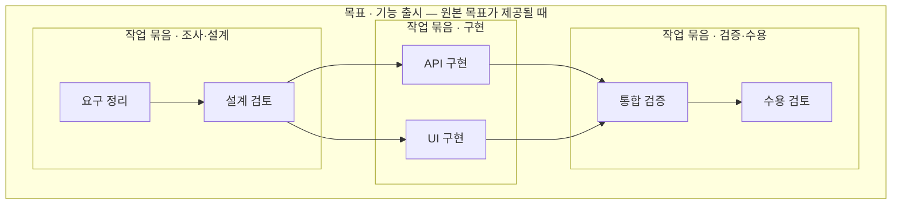

# 업무·세션·Agent 흐름 개편

기준: 2026-11-13 KST. 사용자는 Demian의 주요 미션을 cross-platform,
cross-session으로 Task와 subagent를 조직하고 최종 목표를 수행하는 시스템으로
정의했다. 개별 로그 목록을 네 탭에서 반복하는 구성을 대체한다.

2026-11-13 실제 cowork 실행 후속: 조정자 → sorter → verifier → 종합의 실제
4회 모델 요청·3개 호출·61개 정규 이벤트를 격리 QA에서 확인했다. 그룹 안의
멤버 ID는 해당 협업 그룹 범위에서 구분하고, 원본 부모 호출이 하나로 명시된
협업 그룹은 그 호출 범위 아래에 둔다. 그룹·멤버의 시작·종료 이벤트를 단위별
상태에 표시한다. 현재 정규화 계약은 cowork 결과 상태를 제공하지 않으므로
`종료 관측 · 결과 미확인`으로 표시하며 성공·업무 수용으로 올리지 않는다.
서로 다른 종료 근거와 종료 뒤의 시작은 충돌로, 시작 또는 종료가 누락된
생명주기는 부분 관측으로 남긴다. 기존 이벤트 payload·digest는 바꾸지 않는다.

후속 native SDK `8a7f7f2`는 새 실행의 버전 1 flow metadata에 검증된 멤버 ID와
명시 `dependsOn`을 제공하고, 멤버 호출 시작에 group/member ID를 추가한다.
Track `fc87202`는 이를 현재 인가된 Run 이벤트로부터 읽어 **협업 그룹 → 멤버
범위 → 호출 → 도구**로 중첩하고, 선행 멤버 → 후속 멤버를 별도 typed edge로
표시한다. 기존 metadata가 없는 기록은 미확인으로 남긴다. 이름·agent·시각·
순차 설정으로 소속이나 의존성을 추정하지 않으며 과거 payload·digest를 바꾸지
않는다. 계획은 최대64멤버로 제한하고, 지원하지 않는 버전·형식·한도·계획 밖
멤버·계획/호출 소속 충돌과 잘린 node는 부분 관측으로 표시한다.

새 실제1Run/61event에서는 멤버2·호출3·그룹8·전체12node/21edge를 대조했다.
상태 갱신 뒤 node만 남던 문제는 renderer가 dimensions를 버려 연결 포트가
초기화되는 원인이었다. `0a6a900`은 같은 크기의 측정값을 보존하고, 변경된 그룹은
재측정한다. 실제 갱신·선택 후21edge, sorter 그룹 접기 후20edge와 선행 대표선의
원본 `sorter → verifier`, seq16을 확인했다. 내부 경로·단위별 상태·경계 관계와
390px 폭도 대조했다. 화면 캡처에 근거한 시각 품질 판정은 하지 않았다.
Trace·Trail은 Run 미선택 상태에서도 현재 필터의 실행 선택 안내를 제공한다.
native SDK 변경은 별도 worktree의 로컬 commit이고 운영 전환하지 않았다.
Track의 새 API·웹은 아래 후속에서 운영 반영했다. 실제 병렬 분기·합류, 교차 앱·추가 기기의
전체 업무는 후속이다. 실기 경계와 원본 보존은
[협업 연결 검증 기록](native-cowork-flow-verification.json)에 구분했다.

2026-11-13 운영 후속: API와 웹 `0a6a900`을 같은 동결 release로 전환했다.
그룹 내부 탐색·명시 멤버 연결·선행 관계 consumer와 edge 유지 수정이 포함된다.
운영 HTTP18자산의 bytes/MIME, 실제 허용 Task 두 개의 저장 보기·revision409·
삭제와 기존 이력·원본 서비스를 대조했다. 운영 native SDK/worker는 변경하지
않았으므로 기존19Run에 없는 새 metadata를 생성하거나 추정하지 않는다.
격리 실기의12node/21edge·8그룹 검증과 운영 자산 게시를 구별하며, 이번 전환에서
새 운영 브라우저 상호작용·Entra GUI를 확인했다고 하지 않는다.
[동결 업그레이드 기록](track-runtime-upgrade-verification.json)에 실제 범위를 남겼다.

## 화면별 책임

2026-11-13 실제 coordinator QA에서 그룹의 종료 표시를 보완했다. Run이 취소돼도
호출 자체의 종료 이벤트가 없으면 취소·실패로 추정하지 않고 **Run 종료 · 호출 종료
미확인**으로 표시한다. 원본 `agent.invocation.cancelled`가 있으면 취소 이벤트로,
서로 다른 종료 근거가 겹치면 근거 충돌로 표시한다. 그룹을 접거나 네 보기의
공통 범위로 선택해도 이 구별과 원본 관계를 유지한다. 실제 위임 도구의 실패와
실행되지 않은 하위 Agent를 성공한 작업 묶음으로 만들지 않는다.
`native-coordinator-verification.json`에 실제 실패 경계와 UI 검사를 분리했다.

후속 실제 중첩 위임에서는 원본 invocation 관계와 같은 부모 ID를 가진 lifecycle
관계가 겹치는 문제를 확인했다. 같은 source/Run/부모/자식이며 부모 근거가 명확한
경우 하나의 `invocation-parent` 선으로 표시하고 두 근거의 sequence와 원본 관계
설명을 합친다. 다른 관계 종류·Run·상충하는 부모 근거는 합치지 않는다. 원장과
원본 relation ID는 바꾸지 않는다. 그룹 요약의 도구 `ok=true` 근거는 성공 보고로
표시하며 업무 수용과 구별한다. 실제63event에서 전체10node/15edge/5그룹과
coordinator 묶음5node/5edge·네 보기 유지·390px를 대조했다.

산출물도 Session → Run의 중첩 그룹 안에서 탐색한다. 결과 실선과 첨부 귀속
점선을 구분하고 node/edge 상세에 identity·종류·관측 범위를 표시한다. 개요에서는
그룹 요약으로, 내부 흐름/상세 깊이에서는 개별 산출물로 전환한다. 여러 Task의
화면 묶음은 명시적인 사용자 구성으로 유지하며 artifact 파일 이름이나 기록 순서로
Task 묶음·의존 관계를 만들지 않는다. 세부 계약은 `artifact-flow-integration.md` 참고.

최신 관계 그룹: 원본 세션별 읽기 계약을 바탕으로 peer 연결 → 대화 → 메시지/
처리 영수증을 중첩 문맥 그룹으로 탐색한다. 실제 Run은 기존 Session/Run 그룹에
남기고 경계를 넘는 관계선으로 연결한다. 부모 Run ID가 없는 managed-child의
부모 호출 참조는 미확인 상태로 그룹 밖에 둔다. 같은 대화의 여러 영수증은
소속선을 중복 생성하지 않는다. 합성 QA의3Run·7그룹으로 내부 탐색·breadcrumb·
키보드·390px·계정 변경 제거를 검증했다. 실제 관계 실행으로 계산하지 않는다.
구체 계약·제약은 `session-relations-integration.md`에 기록한다.

| 화면 | 답할 질문 | 기본 표현 | 상세와 연결 |
| --- | --- | --- | --- |
| Track | 어느 업무에 누가 참여하고 무엇이 결정을 기다리는가? | Projects 업무 원본 + 동일 업무에 명시 연결된 고유 Run·세션·장치 요약 | 연결된 Run 선택, 협업 Map, 현재 실행 제어·승인 |
| Trail | 무엇이 요청되고 바뀌고 인계되었는가? | 도구 요청·종료를 묶은 경과, 승인·실행 전이·산출물·파일 근거 | 원본 sequence, 파일/산출물 metadata, Trace 이동 |
| Trace | 실행 안에서 어떤 호출과 도구가 어떻게 진행되었는가? | Run→호출→도구/승인 node+edge, native lineage와 결과 보강 | 호출·thread·turn·시도, 요청/시작/종료·결과, 원본 근거 |
| Map | 같은 목표를 위한 업무·세션·위임·협업이 어떻게 연결되는가? | 업무→연결 Run, Workspace/Session 소속, 명시된 위임·peer·의존 관계 | node 상세, 관계 종류·방향·출처·근거, 관련 Run 이동 |

목표 계층·Task dependency·peer를 수집하지 못한 상태를 빈 완료 그래프로
위장하지 않는다. 현재 Run의 성공은 Task 수용이나 목표 달성을 뜻하지 않는다.
장치 표시는 등록된 source metadata이며 provider 이름으로 OS를 추정하지 않는다.

## 관계와 식별

- Task는 Projects source+Project+Task ID가 같을 때만 묶는다. 제목·저장소·시간이
  비슷하다는 이유로 같은 업무나 같은 목표로 합치지 않는다.
- Run/Session/Invocation은 source-qualified ID로 구별한다. 고유 Run 수와 호출,
  cowork member, native item, peer connection 수를 섞지 않는다.
- 업무 연결과 소속은 점선, 명시된 실행 관계는 실선, 기록 순서는 별도 색·설명을
  사용한다. 기록 순서는 실행 인과·Task dependency를 보장하지 않는다.
- 관리형 child는 부모와 자식 Run의 명시 참조로 세션을 넘어 연결한다. 부모의
  Task binding을 자식에게 자동 복사하지 않는다. 접근 가능한 원본 참조만 표시한다.
- Native item과 call ID의 정확한 일치로 도구를 연결한다. lineage 관측만으로
  호출이 성공·완료됐다고 승격하지 않는다. 시도/호출이 모호하면 충돌로 보존한다.

## UI 공급원과 구현

[ui.pydemia.ai](https://ui.pydemia.ai)의 `pyd-flow-canvas`,
`pyd-flow-layout`, `pyd-flow-alignment` registry source를 실제 편입했다.
원본 checksum과 변경은 `vendor/pydemia-ui/provenance.json`에 기록한다.
React Flow 12.12.0과 추가 의존성20개의 라이선스 원문을 보존한다.
AgentTrail은 node/edge 탐색의 구조 reference이며 소스를 복사하지 않았다.

캔버스는 조회 전용으로 pan/zoom/minimap과 전체 맞춤을 제공한다. Node 선택은
상태·식별자·실행 근거·연결을, edge 선택은 출발·도착·종류·출처·sequence를
우측 상세에 표시한다. 같은 항목을 검색 가능한 버튼 목록으로 탐색할 수 있다.
좁은 화면에서는 상세가 아래로 이동한다. 새 이벤트/lineage로 topology가 바뀔
때만 자동 맞춤하며 상태 갱신·선택마다 사용자의 viewport를 초기화하지 않는다.

## 데이터 경계와 후속 개발

| 단계 | 현재 결과 | 남은 조건 |
| --- | --- | --- |
| 1. 실제 실행 해석 | native lineage 별도 인가 조회, source/run/item 정확한 결합, 기존 immutable 원장 보존 | 공개 UI·scope 철회·재접속 증거를 현재 revision에 연결 |
| 2. 실행 분석 | 호출/도구/승인 Flow, 경과 Trail, 업무별 세션 요약 | 도구 outcome·요청/실행 구간의 실제 원본 대조 |
| 3. 업무·협업 Map | 같은 Task의 여러 source/Session, 명시 Run 관계 closure, Projects 실제 Task dependency·선행 화살표·관계/현재 revision 상세·철회 시 URL 제거 | 실제 goal/cowork/managed-child/peer·artifact 관계 사례 |
| 4. 목표 수행 | 원본 업무 생성·내용 검토→기존 Session 배정→native acceptance→binding 복구, 실제 동일 Task·Session2·Run2 대조 | 자동 subagent 조직화, 검증/수용 근거 연결 |
| 5. 교차 앱 | Projects 원본 요약·Map 이동·단절 중 업무 편집/복구 실기. Demian 요약 BFF/UI·분리 native web에서 장애 중 실제 Run 성공·자동 복구·같은 Map 이동(QA 소유자 범위) | Docker DB/API/worker 복구 후 Demian 원본 web 적용, Assistant/desktop 계약, 두 번째 장치 |

Projects의 dependency는 native Link의 `depends_on`을 서명된 조회 계약으로 연결했다.
관계 소유 Project와 양쪽 업무의 현재 native/service 권한을 모두 확인하며, 원본
A→B 의존 관계는 화면에서 선행 B→의존 A로 표시한다. 실제 QA 관계1건·업무2·Session2·
기존 Run2의6node/5edge와 원본 ID·revision을 대조했고 업무 todo/r1·todo/r2를 유지했다.
미지원 계약·한도·권한 철회는 각각 구분한다. Demian의 해당 검증 Run에는 goal/cowork/managed-child/peer 이벤트가
없다. mock 관계 검사를 실제 subagent 조직화 성공으로 집계하지 않는다.
권한을 확장하거나 원본 producer WIP를 임의 배포하여 이 공백을 숨기지 않는다.

새 조회는 현재 Run/Session 접근을 전후 재확인하고, 업무 연결 Run은 최신 Projects
권한과 교차 검사한다. lineage/도구 원문·인수·출력·메시지는 journal에 추가하지
않는다. 부분 수집·한도·연결 실패·미지원은 각각 표시한다.

실제 Session2·Run2 지도에서 ID 정렬 때문에 소속 연결이 교차하는 증상을 확인했다.
Session→Run의 명시 소속을 행 순서에 반영하고, 도구는 기존 canonical sequence로
정렬한다. 이는 배치 변경이며 업무 dependency나 실행 인과를 추가하지 않는다.
Map·Trace의 조직화 지원 펼침에서는 현재 worker 전역 선언과 선택 provider의 도구
관리 방식을 구분한다. 실제 installed runtime의 외부 provider 분기와 공개 UI를
대조했으며 하위 실행의 존재·성공·대상 준비로 표시하지 않는다.

수용 기준은 AT-04/05/08/12/18/19에 연결한다. 기존 완료 조건을 느슨하게 바꾸거나
기능 추가 개수로 전체 진척률 분모를 바꾸지 않는다. 전체 현황은 `goal-status.md`가
기준이며, 실제 교차 앱 목표 수행은 아직 완료되지 않았다.

## Node group과 탐색 깊이

2026-11-13 후속: 계정별 저장·선택 복원은 AT-12-G06으로 구현했다.
[계정별 Flow 저장 보기](saved-flow-views.md)에 현재 HTTP/SQLite·합성 브라우저
검사와 실제 owner API·운영 반영, 미검증 Entra GUI를 구분한다. 아래의 임시
화면 묶음·공통 범위와 별도로 계정별 보기를 명시적으로 저장·불러온다.
전체14/21은 유지한다.

2026-11-12 사용자 보완: 개별 node·edge로 정리하기 어려운 업무 묶음을 group으로
표시하고, 묶음 내부의 flow를 단계적으로 깊게 탐색한다. AT-12의 그룹·계층·접힘
수용 조건으로 추가하며 기존 21개 기준과 실제 미완료 범위를 유지한다.

### 묶음을 만드는 기준과 화면 계약

여러 Task가 하나의 목적·산출물·검토 단위를 만들거나, 내부의 분기·합류·인계를
따로 읽어야 한다면 작업 묶음으로 표현한다. 원본 목표/하위 업무나 사용자의
명시 선택을 근거로 삼는다. node가 많다는 이유만으로 임의 개수씩 묶거나,
이름·시간·같은 저장소만으로 공동 목표를 추정하지 않는다.

| 묶을 상황 | 묶음의 의미 | 내부에서 확인할 내용 |
| --- | --- | --- |
| 같은 목적·산출물을 위한 여러 Task | 작업 묶음 | 구성 Task, 명시된 선행 관계, 결과와 검토 범위 |
| 조사·구현·검증처럼 나누어 읽을 단계 | 원본 단계 또는 사용자가 정한 화면 묶음 | 단계 안의 순차·병렬·합류와 단계 밖의 선행/후속. 화면 이름 자체는 실행 순서를 만들지 않음 |
| 여러 Agent가 나누어 수행하는 실행 | 원본 호출·협업 묶음 | coordinator/하위 호출, 도구, 승인, 결과. 참여와 위임을 구별 |
| 여러 Session·플랫폼에 걸친 같은 Task | 명시 Task 연결 범위 | 고유 Run과 Assistant 실행을 구분하고 각 실행의 출처·상태·인계 근거 확인 |
| 동일 작업을 다른 관점에서도 참고 | 공유 참조 | 실제 node 한 개와 참조 관계. 중복 실행 집계나 부모 소속 변경 없음 |

기본 읽기 순서는 **작업 묶음 → 하위 Task/묶음 → 참여 실행 → 호출·도구·근거**다.
이는 탐색 경로이며 모든 producer에 강제할 고정 schema가 아니다. 원본 Goal이나
work package를 아직 읽지 못하면 `화면 묶음`으로 표시한다. 플랫폼·장치·Agent별
필터를 작업 소속이나 실행 의존 관계로 바꾸지 않는다.

캔버스 상단에는 묶음 기준·깊이 preset·현재 경로, 본문에는 그룹과 관계,
선택 상세에는 목적/범위·구성·대기·결과·원본 근거를 둔다. 접힌 그룹에도
구성 단위별 수와 상태 분포·부분 관측·순환을 남긴다. 선행 관계는 알려진
관계로, 승인 대기는 현재 원본 상태로 표시하며 확인하지 못한 실행 차단을
확정하지 않는다. 그룹 전체를 Run 성공만으로 완료 처리하지 않는다.

선택은 상세 열기, 펼침은 내부 표시, `내부 흐름`은 해당 가지에 초점을 맞추는
동작으로 구별한다. 다른 가지의 접힘은 유지하고 상위 복귀 시 선택·카메라를
복원한다. 확대 배율만으로 멤버를 숨기거나 계층을 바꾸지 않는다. 포함은
그룹 면·제목·여백으로, 선행/위임/소속은 종류별 관계선과 상세 근거로 표현한다.
동급 묶음에는 같은 시각 규칙을 쓰고 선택·경고·현재 실행의 차이를 별도 표시한다.
좁은 화면의 상세와 키보드 목록에서도 같은 멤버·원본 관계를 탐색한다.

아래는 그룹 종류·행동의 목표 계약이다. 현재 구현·실기 증거와 남은 조건은
이 절의 AT-12-G01~G05 및 `group-workspace-verification.json`으로 구별한다.

| 그룹 | 실제 소속 근거 | 경계와 내부 |
| --- | --- | --- |
| Project | Projects source + Project ID | 같은 원본 Project의 업무와 명시된 하위 묶음. 다른 Project와의 선행 관계는 경계 밖으로 연결 |
| 업무 묶음 | 원본 work package/명시적 업무 구성, 또는 사용자가 고른 화면 묶음 | native 묶음과 시각적 묶음을 구별. 후자는 업무·의존성·담당자·원본 상태를 변경하지 않음 |
| Task 실행 | 동일 source·Project·Task에 연결된 binding | 여러 Session·장치의 Run을 함께 탐색. 다른 Task의 실행을 제목·시간으로 합치지 않음 |
| Session | source-qualified 원본 Session ID와 Run 소속 | 실제 Run 및 그 내부 호출. 여러 Task가 공유하는 Session을 한 업무의 소유로 단정하지 않음 |
| Run | source-qualified 실제 Run | 호출·도구·승인·관측 단계. invocation/member를 독립 Run으로 세지 않음 |
| 호출·협업 | invocation parent 또는 native cowork group/member 참조 | 관리형 child Run·cowork member·peer를 구별. 시각적 group과 native cowork 객체는 별개 |

기본 그룹 기준은 업무 연결 또는 Session이며, 사용자는 묶음 기준과 탐색 깊이를
바꾼다. `묶음 개요`는 상위 그룹을 접어 경계 사이의 흐름을, `실행 구조`는
Task·Session·Run 관계를, `상세 근거`는 호출·도구·승인까지 펼친다. 같은 데이터와
같은 원본 ID를 유지하며 새 실행이나 완료를 합성하지 않는다.

그룹을 선택하면 이름·종류·소속 근거·현재 포함 항목·원본 출처·관측 범위를
표시한다. Task·Run·Session·호출 수와 상태 분포는 각각 계산하며, Run 성공만으로
그룹이나 목표 전체를 완료 색상으로 표시하지 않는다. 미확인·부분 조회·순환은
접힌 그룹에도 남긴다. `내부 흐름`은 해당 묶음을 펼쳐 초점을 이동하고 경로를
표시한다. `상위 묶음`·`전체 흐름`으로 문맥을 복원한다.

접기 전후에도 edge의 방향·종류·출처·원본 근거를 보존한다. 같은 경계 endpoints·
종류·출처인 관계만 대표선으로 묶고 원본 관계 수를 표시한다. 대표선을 선택하면
개별 관계·끝점·근거를 확인할 수 있다. 내부 관계는 사라진 것으로 처리하지 않고
그룹 상세의 내부 관계 수·순환과 펼침으로 접근한다. 시각적 포함을 의존성으로
변환하거나 다른 종류의 관계를 하나의 의미로 합치지 않는다.

화면 묶음은 현재 허용된 Task를 골라 이름을 붙이는 탐색 단위다. 첫 구현의
범위는 현재 화면 내 생성·해제·접기/펼치기이며, 재조회 때 존재하는 동일 ID의
묶음을 유지한다. 구성 업무의 접근이 사라지면 해당 화면 묶음과 이전 이름도
제거한다. 계정별 저장 보기는 별도 원본 권한 재검증과 서버 저장을 구현했다.
다음 접속에서 명시적으로 불러온다. 저장하지 않은 임시 상태와 구분한다.

| 화면 | 그룹으로 정리할 내용 | 현재 구현과 후속 |
| --- | --- | --- |
| Track | 업무 묶음별 참여 Session·고유 Run·승인 대기와 다음 행동 요약 | 현재 화면의 공통 범위와 업무/실행 요약 구현. Flow 표시 상태의 계정별 저장·명시 복원 운영 반영, 실제 Entra GUI는 후속 |
| Trail | 같은 업무 묶음의 변경·산출물·인계 경과를 Run별 lane으로 비교 | 공통 범위의 실행별 이력 구현. 각 Run의 sequence를 보존하고 여러 Run의 시간을 하나의 인과 순서로 합치지 않음 |
| Trace | Run·호출·협업 범위 안의 도구/승인과 원본 sequence | 중첩 그룹·깊이·내부 탐색 구현. 실제 호출 참조가 없는 도구는 상위 호출 미상으로 유지 |
| Map | Project·Task 묶음과 여러 Session·Run의 선행/위임/협업 흐름 | 원본/명시 연결 그룹과 현재 화면 Task 묶음 구현. Goal·work package의 원본 계층은 해당 계약이 생긴 뒤 추가 |

`Project → 업무 묶음 → Task`와 `Run → 호출 → 도구`는 소속을 탐색하는 예시다.
모든 실행을 이 고정 계층에 강제로 맞추지 않는다. 하나의 Session을 여러 Task가
공유하면 바깥에 남겨 명시 관계로 연결하며, 서로 다른 그룹에 중복 소속시켜 Run
수를 늘리지 않는다. 그룹 사이의 실제 dependency·위임은 포함 경계와 별도 edge다.

현재 화면의 공통 범위는 선택 그룹의 source-qualified ID와 현재 허용 멤버를
Track/Trail/Trace/Map 사이에 전달하고 각 화면 진입 때 재검사한다. 이 공통 선택은
현재 세션의 임시 범위다. 별도 저장 보기는 Flow의 사용자 묶음·분류·깊이·접힘·
내부 초점을 서버에 저장하고 다음 접속에서 명시적으로 불러온다. 현재 권한과
그래프를 다시 확인하며 제목·접힘 상태를 URL에 넣거나 철회된 이름을 로컬
저장소에서 복원하지 않는다. 공통 범위의 자동 재접속 복원은 구현하지 않았다.

Pydemia의 기존 `pyd-flow-group` renderer와 parent-relative node 배치를 재사용한다.
상위 면·그룹 제목·여백으로 소속을 보이고, 원본/연결/화면 묶음의 근거를 명시한다.
독립 선택·접기·내부 탐색 때문에 필요한 경계는 유지하며 같은 굵기의 박스를
중첩하는 방식으로 깊이를 표현하지 않는다. 그룹 크기를 포함해 배치하고 자식이
부모 밖으로 벗어나거나 서로 겹치지 않도록 검증한다.

수용 검사: 실제 업무 두 개의 화면 묶음 생성·해제, nested group 접기/펼치기,
내부 초점·상위 복귀, 대표선 원본 근거, 순환·고립·공유 Session·서로 다른 source의
동일 ID, 상태 갱신 중 선택/접힘 유지, 권한 제거 시 그룹 이름·멤버 제거,
키보드 목록·그룹 버튼·390px 상세 이동을 확인한다. 구현·fixture·공개 실기를
구분하며 배포 후 현재 revision의 증거로만 완료를 판단한다.

Reference: [Pydemia FlowCanvas registry](https://ui.pydemia.ai/r/pyd-flow-canvas.json),
[React Flow Sub Flows](https://reactflow.dev/learn/layouting/sub-flows).

### 작업 묶음 중심 탐색 시나리오

사용자 보완의 핵심은 여러 Task가 함께 수행하는 일을 하나의 group으로 읽고,
필요한 가지를 펼치면서 그 안의 순서·병렬 수행·대기·인계를 이해하는 것이다.
기존 세 가지 깊이 preset은 시작점이며 실제 계층 수를 세 단계로 제한하지 않는다.
그룹 선택은 요약과 구성·연결 근거를 열고, `내부 흐름`은 해당 가지를 펼친다.
다른 가지의 접힘은 유지한다. 화면 전체를 매번 상세 node로 채우지 않는다.

아래는 기획 설명용 예시이며 현재 운영 Task나 실제 실행 검증 결과가 아니다.
묶음 간 화살표는 이 예시에서 명시한 선행 관계다. 박스의 포함 관계와 구별한다.

개요에서는 `조사·설계 → 구현 → 검증·수용`의 그룹과 경계 관계를 읽는다.
구현 그룹을 펼치면 API·UI 업무의 병렬 분기를, 특정 업무로 들어가면 연결된
Assistant 실행·역할과 Demian Session/Run을, Run 내부에서는 호출·도구·승인과
결과 근거를 읽는다. 원본 목표·업무 묶음이 없으면 현재 허용된 Task의 화면
묶음으로 시작하고 `화면 묶음`으로 표시한다. Task 이름으로 목표·단계를 생성하지 않는다.

화면은 기존 SNB, 흐름 캔버스, 선택 상세를 유지한다. 캔버스 위에는 묶음 기준·
깊이 preset·탐색 경로를 두고, 캔버스에는 현재 깊이의 그룹·관계를,
상세에는 선택한 그룹 또는 node/edge의 근거를 배치한다. 상세 node를 선택해도
캔버스를 로그 목록으로 대체하지 않는다. 전체 펼침과 그룹별 펼침은 구별한다.

| 읽는 단계 | 캔버스에서 읽을 내용 | 다음 행동 |
| --- | --- | --- |
| 묶음 개요 | 목적별 작업 묶음, 구성 업무 수, 진행·대기 분포, 다른 묶음과의 선행 관계 | 묶음 선택 → 요약·대기 근거 확인 |
| 묶음 내부 | 하위 Task 또는 하위 묶음, 명시된 병렬 분기·합류·인계, 외부 선행/후속 연결 | 선택한 가지만 펼침, 원본 관계 선택 |
| 실행 구조 | Task에 참여하는 실제 Session/Run·Assistant 실행·역할, 명시된 위임·peer 연결 | 특정 실행 또는 협업 범위로 이동 |
| 상세 근거 | 선택 실행의 호출·도구·승인, 요청/종료 구간·실패·산출물 metadata | Trace 상세·Trail 경과·원본 앱 이동 |

이 단계는 읽는 순서다. 실행 종류마다 계층은 다를 수 있고 Session이 여러
업무에 참여할 수 있다. 동일 node를 여러 그룹의 실체로 복제하지 않는다.
Agent·장치·플랫폼은 참여 정보와 필터로도 보여 주며, 실제 소속 근거 없이
새로운 부모 그룹으로 삽입하지 않는다. 조회 순서만 있는 병렬/합류는 미확인이다.

### 그룹 요약과 상세의 내용

접힌 그룹은 이름·종류·소속 근거, 단위별 구성 수, 실행/대기 분포와 부분 관측
여부를 표시한다. 그룹의 목적과 다음 행동은 원본 업무·명시된 승인/의존 근거가
있는 범위에서만 보강한다. 현재 항목 수만 아는 경우 전체 진행률로 환산하지 않는다.

| 상세 항목 | 표시 계약 |
| --- | --- |
| 목적·범위 | 원본 목적/수용 조건의 현재 허용된 요약 또는 사용자가 정한 화면 묶음 이름. 목적 미제공은 미제공으로 표시 |
| 구성 | Task·고유 Run·Session·Assistant 실행·역할·호출을 단위별로 구분하고 선택 가능한 하위 목록 제공 |
| 진행 | 원본 Task 상태와 Run 상태 분포를 분리. 전체 분모·수용 기준이 확인될 때만 업무 진행률 표시 |
| 대기·실패 | 승인 대기, 선행 업무 대기, 실행 실패를 각각 해당 Task/Run과 근거에 연결. 부분 조회는 원인 확정으로 표시하지 않음 |
| 입력·결과 | 명시된 업무 입력/수용 조건과 조회 가능한 산출물 metadata·검증/수용 근거. 연결되지 않은 결과는 미확인 |
| 경계 관계 | 외부 선행/후속 업무, 위임·handoff·peer를 종류별 목록으로 제공. 상대 그룹과 실제 끝점을 모두 탐색 |
| 관측 범위 | 출처·원본 ID·관측 시각·조회 한도·미지원·단절을 표시. 접힌 상태에서도 불완전함을 유지 |

의존 관계가 모두 확인되지 않으면 `막힘 없음`을 확정하지 않는다. Run이 모두
성공해도 업무 검토나 사용자 수용이 남으면 그룹을 완료로 승격하지 않는다.
화면 묶음에 대한 시작·중단·재시도는 별도 원본 명령 계약이 생긴 뒤 검토한다.
그룹을 만들거나 접는 행동 자체는 원본 실행을 제어하지 않는다.

내부 초점에서도 외부 연결을 경계 요약/목록으로 확인하고 상대 그룹으로 이동할
수 있게 보강한다. 대표선을 누르면 종류별 원본 관계와 실제 끝점으로 이동한다.
상위 복귀 시 탐색 경로와 이전 가지의 접힘·선택을 보존하는 동작을 검증한다.
계정·권한이 바뀐 경우에는 보존보다 현재 권한 재검사가 우선한다.

### 네 화면의 그룹 문맥과 후속 수용 조건

#### Task 묶음의 흐름 해석

2026-11-13 기획 보완: Task 묶음은 여러 작업이 함께 달성하려는 범위를 읽는
단위다. 그룹의 포함 관계, 작업 사이의 선행 관계, 실제 실행의 시간 순서를
각각 표현한다. 아래는 기존 그룹 기능에 적용할 상세 설계이며, 새 runtime
제어 기능이나 모든 항목의 구현 완료를 뜻하지 않는다.

| 흐름 형태 | 개요와 내부 표현 | 근거가 없을 때 |
| --- | --- | --- |
| 순차 작업 | 접힌 그룹 사이에 선행 → 후속 대표선. 펼치면 실제 Task 끝점과 원본 관계 표시 | 기록 시각만으로 선행선을 추가하지 않음 |
| 분기·병렬 작업 | 명시된 선행 업무에서 여러 후속 업무로 갈라지는 구조. 실제 실행 구간이 겹치면 별도로 병렬 실행 표시 | 분기 구조만 확인되면 동시 실행 여부는 미확인 |
| 합류 | 여러 선행 Task에서 후속 Task로 들어오는 관계를 보존. 각 선행 업무의 현재 상태를 따로 표시 | 모든 선행 완료/하나 이상 완료 등의 실행 조건은 원본 policy가 제공할 때만 표시 |
| 위임·인계 | 부모/자식 Run·Assistant 역할·peer의 명시 관계를 종류별 edge로 연결. 다른 그룹으로 이어지는 실제 끝점 유지 | 단순 참여나 같은 Session이라는 이유로 위임 관계를 만들지 않음 |
| 실패·재시도 | 실패한 원래 실행과 새 시도를 각각 유지. 재시도 관계가 제공되면 연결하고 업무 상태와 구별 | 새 Run이 생겼다는 이유만으로 retry edge를 추가하지 않음 |
| 공유 작업 | 하나의 실제 node를 유지하고 다른 묶음에서는 참조 관계로 접근. 고유 Run 집계에서 중복 제외 | 여러 묶음에 포함시키려는 구성이 충돌하면 소속을 확정하지 않고 관계로 표시 |
| 순환·미확인 | 접힌 그룹에도 순환·부분 관측 표시. 내부 관계 목록에서 원본 끝점 확인 | 관계 부재와 조회 실패를 구별 |

그룹 경계의 대표선에는 관계 종류와 원본 관계 수를 표시한다. 예를 들어
`선행 관계 3건`은 현재 보이는 두 묶음 사이의 원본 dependency 세 건이며,
그룹 안의 모든 Task가 서로 의존한다는 뜻은 아니다. 서로 반대 방향이거나
위임·의존·소속처럼 의미가 다른 관계는 별도 선으로 유지한다. 접힌 상태에서
자기 그룹 안으로 숨겨진 관계는 내부 관계 수로 남긴다.

#### 선택한 가지를 깊게 읽는 동작

| 동작 | 사용자에게 보일 결과 | 구현·검증 범위 |
| --- | --- | --- |
| 그룹 선택 | 우측 상세에 목적/범위, 단위별 구성·상태, 명시된 대기·실패, 산출물과 외부 관계 표시 | 기존 구성·관측 요약 구현. 목적·입력·수용 기준은 원본 제공 범위에 따름 |
| 이 그룹 펼치기 | 선택한 묶음의 내부 node/하위 그룹을 드러내고 다른 가지의 접힘 유지 | 현재 화면 구현. 실제 복합 협업 사례 추가 검증 필요 |
| 내부 흐름 보기 | 해당 가지에 초점을 맞추고 breadcrumb 제공. 외부 선행/후속은 경계 관계 상세에서 탐색 | 내부 초점·경계 원본 관계 이동 구현. 실제 분기·합류 전체 시나리오는 후속 |
| 원본 끝점 보기 | 대표선의 실제 관계 목록에서 Task/Run/호출 하나를 선택하면 필요한 조상만 펼쳐 상세 선택 | 원본 node/edge reveal 구현. 서로 다른 의미의 대표선을 합치지 않는 검사 유지 |
| 이전·상위·전체 복귀 | 이전 선택·접힘·카메라 문맥 복원. 크기가 달라지면 현재 캔버스에 맞춤 | 현재 화면 최대32단계 이력 구현. 구조·권한 변경 시 무효화 |
| 같은 묶음을 다른 보기로 열기 | 동일한 현재 허용 멤버를 Track·Trail·Trace·Map에서 각 화면 목적에 맞게 조회 | 현재 화면의 공통 범위 구현·합성 UI/HTTP 검사·게시 확인. 실제 조직화 업무의 운영 대조는 후속 |
| 묶음 저장·다음 접속 복원 | 계정별 저장 후 현재 원본 권한으로 멤버를 다시 확인 | 서버 저장·명시 복원 구현·운영 반영. 합성 UI의 재시작/복원, 실제 owner API 검증. Entra GUI는 후속 |

기본 개요는 작업 묶음과 묶음 사이의 관계를 보여 준다. 특정 가지의 깊이를
바꾸는 조작과 전체 깊이 preset은 별도로 제공한다. Zoom은 위치·배율을
조절하며, 확대·축소만으로 선택한 항목이나 포함 관계를 바꾸지 않는다.
전체 펼침은 명시적으로 실행하고 깊은 중첩 구조에서 내부 탐색을 계속 사용할
수 있게 한다. 좁은 화면에서는 같은 상세를 캔버스 아래에서 열고 그룹·관계
목록을 키보드 대체 탐색으로 제공한다.

후속 수용 시나리오는 `조사·설계 → API/UI 구현 분기 → 통합 검증 → 수용`의
동일한 업무 묶음을 사용한다. 접힌 개요에서 선행 관계를 확인하고, 구현
묶음만 펼쳐 두 Task를 비교하며, 선택한 실행의 도구·실패·산출물을 읽은 뒤
원래 개요로 돌아오는 과정을 검사한다. 여기에 공유 Session, 승인 대기,
실행 실패 후 별도 시도, 권한 철회, 모바일/키보드 사례를 적용한다. 실제
producer가 제공하지 않는 분기 조건·재시도·수용 판정은 합성 자료로만
검사하고, 실제 조직화 실행 검증과 구별한다. 기존 AT-12-G01~G05에 연결하며
전체 goal의 분모를 추가하지 않는다.

Map은 그룹 사이의 조직과 선행 관계, Trace는 선택한 그룹에 참여하는 실행별
호출 흐름을 보여 준다. Trail은 같은 범위의 변경·인계·산출물을 Run별 lane으로,
Track은 그룹별 업무 상태·대기·다음 행동을 요약한다. 여러 Run의 시각을 하나의
전역 sequence나 인과로 합치지 않는다. 구현된 공통 범위 선택에서도 원본 Run의
순서와 그룹의 포함 관계를 별도로 유지한다.

다음은 AT-12 안의 후속 검사 식별자다. 전체 goal의 완료 개수·분모를 추가하지 않는다.

| 검사 | 기대 결과 | 현재 판정 |
| --- | --- | --- |
| AT-12-G01 | 서로 선행 관계인 작업 묶음을 접어도 방향·종류·원본 관계 수를 유지하고 내부 node로 이동 | 그룹/대표선 기반 구현. 위 예시의 전체 시나리오 실기는 미검증 |
| AT-12-G02 | 선택한 가지를 여러 깊이로 탐색하고 상위/전체로 복귀. 다른 가지의 상태와 선택 문맥 보존 | 현재 화면의 이전/상위/전체 복귀에서 선택·접힘·카메라 복원 구현. 합성 중첩 그룹·경계 상세·크기 변경·철회 검증. 실제 조직화 업무의 전체 시나리오는 별도 |
| AT-12-G03 | 단위별 상태·승인/선행 대기·입출력 근거와 부분 관측을 그룹 상세에서 구분 | 현재 metadata의 단위별 상태·명시된 승인/런타임 대기·실패·검토와 선행/후속 관계·산출물 근거를 통합. 목적·입력·수용 기준은 원본 미제공으로 표시. 실제 조직화 업무의 전체 시나리오는 미검증 |
| AT-12-G04 | 그룹 범위를 Track/Trail/Trace/Map으로 옮기고 화면별 표현에서도 동일 원본을 유지 | 공통 범위 선택·네 보기 전환·중첩 역할/Run 문맥·철회 제거 구현, 합성 UI와 운영 API·게시 assets 확인. 계정별 저장도 운영 반영·owner API 검증. 운영 Entra GUI·실제 조직화 업무 대조는 후속 |
| AT-12-G05 | 공유 Session·교차 플랫폼·중복 ID·철회·순환에서도 중복 집계나 잘못된 포함/의존 관계가 없음 | 기존 fixture 증거 유지. 실제 child/peer·교차 장치 업무는 미검증 |
| AT-12-G06 | 계정별 Flow 표시 상태를 저장하고 현재 권한으로 명시 복원. 계정 분리·동시 수정·철회 처리 | 구현·합성 UI·HTTP/SQLite 검사와 동결 API/웹 운영 반영·실제 허용 Task owner API 검증. Entra GUI·추가 기기 재접속은 미검증 |

기존 `FlowGroupSummary`·`FlowGroupInspector`를 확장하며 요약만을 위한 두 번째
실행 원장이나 그룹 실행 상태를 만들지 않는다. Pydemia renderer와 기존 ID·
권한 경계를 유지한다. 그룹 요약, 외부 문맥 탐색, 네 화면 공통 범위 선택,
계정별 저장 보기 순서 중 현재 metadata 요약·문맥 탐색·공통 범위까지 구현했다.
계정별 저장은 `saved-flow-views.md`에 구현·운영 반영 증거를 연결했다.
실제 조직화 시나리오와 운영 Entra GUI 검증은 남아 있다.

그룹 요약의 현재 구현은 업무·Run·Assistant 실행·역할·호출·도구의 상태를
종류별로 나눈다. 명시된 Run 승인 대기·역할 연결/런타임 대기·실패·업무 검토는
선택 가능한 원본 항목으로 제공한다. 권한 이벤트 node의 과거 상태로 현재 승인
대기를 추정하지 않는다. 선행·후속 업무는 원본 방향과 현재 상태만 보여 주며
실행 차단 판정으로 바꾸지 않는다. 해당 Run과 명시적으로 연결된 산출물 결과와
귀속 참조를 구분하고 metadata 조회를 내용 검증으로 계산하지 않는다.

요약은 현재 허용된 node/edge의 교집합에서 다시 계산한다. Run alias·산출물은
중복 집계하지 않고, 그룹 밖의 같은 Run 관측과 충돌하거나 산출물 소속이
불일치하면 부분 관측으로 남긴다. 목적·입력·수용 조건의 원본 필드는 현재
읽기 계약에 없으므로 제목이나 도구 이름으로 생성하지 않는다.

### 탐색 복귀의 문맥

`이전 탐색 복원`은 직전 상세 이동 전의 선택·접힘·화면 위치로 돌아간다.
상위 breadcrumb와 `전체 흐름`은 해당 범위를 방문한 기록이 있으면 복원하고,
없으면 현재 허용된 범위에 새로 맞춘다. `전체 흐름 맞춤`은 새 맞춤의 명시적
행동으로 이력을 비운다. 역할/관계 상세를 읽기 위해 펼친 가지는 복귀할 때
진입 직전의 접힘 상태로 되돌린다. 새 목표·Run·의존 관계를 생성하지 않는다.

이력은 현재 화면의 최대32단계이며 node/edge/group 키와 기하 정보만 보관한다.
계정·원본 구조·관계 끝점·그룹 소속이 바뀌면 이전 이력을 폐기하고 현재 초점과
접힘 설정에서도 사라진 ID를 제거한다. 상태·제목·관측 시각만 바뀐 재조회는
이력을 유지한다. 현재 허용된 원본 metadata를 다시 읽으며 과거 제목이나 상세를
이력에서 복원하지 않는다. 서버 저장·다른 화면 공유·재접속 복원과 구분한다.

화면 크기가 같으면 저장한 pan/zoom을 복원한다. 크기가 바뀌면 선택·접힘을
복원한 뒤 현재 캔버스에 맞추므로 데스크톱 좌표를 모바일에 강제하지 않는다.
초기화된 viewport와 명시된 node bounds로 카메라를 적용하며, 그룹 버튼의
Enter가 바깥 node 선택으로 전파되지 않도록 한다. 조회 화면은 작은 확대 배율도
허용해 좁은 캔버스에서 전체 맞춤이 node를 잘라내지 않게 한다.

### Assistant 업무 실행의 중첩 그룹

Assistant 연결에서는 현재 Projects Task → 원본 WorkExecution → 실행 내
Work package → 역할로 탐색한다. 같은 Task의 Demian Run과 Assistant 실행은
Task 그룹에 함께 놓되, 고유 Run 수와 Assistant 실행 수를 별도로 센다.
Work package는 원본 소속이 같은 역할 두 개 이상인 경우에만 만든다. 여러
실행이 공유하는 thread·turn·runtime Task 참조는 바깥에 두고 참조선으로
연결한다. 이 참조를 Demian Session이나 실행 선후 관계로 바꾸지 않는다.

Track는 현재 업무 상태와 실행별 역할 요약, Trail은 원본 상태의 경과,
Trace는 역할·시간·sequence·오류와 연결 근거, Map은 Task 의존 관계와
실행 조직을 표시한다. 현재 Assistant 계약에는 도구 호출·산출물 본문이
없으므로 비어 있는 근거를 생성하지 않고 제공 범위를 명시한다.

묶음 개요 → 실행 구조 → 상세 근거의 세 깊이, 개별 접기/펼치기, 내부 초점,
breadcrumb·상위 복귀와 목록 탐색을 공통 사용한다. Task 여러 개의 화면
묶음은 내부 실행 그룹을 함께 포함한다. 대표선에서 각 원본 관계를 열며,
Projects 또는 원본 읽기 권한이 사라지면 이전 그룹 이름·멤버·상세도 제거한다.
화면 묶음의 서버 저장·명시 복원은 구현·운영 반영했고 합성 UI에서 재접속을
확인했다. 실제 Entra GUI에서의 재접속은 후속 검증이다.

v2 참조가 현재 Assistant·Projects·native 권한과 기존 operation receipt를
만족하면 역할 → 실제 Demian Run 관계를 추가한다. 접힌 그룹의 대표선을
선택하면 실제 끝점과 Operation/Session/Run 근거를 읽고, Run에서 동일 실행의
Trace로 이동한다. native Run을 Assistant 실행 그룹의 복제 멤버로 만들지 않는다.
원본 참조 미제공·미설정·단절·철회는 구분하며 현재 권한이 사라진 관계·ID는
제거한다. 중첩 그룹·상세 이동·390px·철회는 합성 UI에서 확인했고, 운영 실제
업무 수행 검증은 별도다. `assistant-demian-observer-verification.json` 참고.

로컬 synthetic 환경에서 두 Task/실행 두 개/역할 네 개/공유 thread와 실제
canonical producer·HTTP·SQLite Store 경계를 사용해 네 보기·중첩 탐색·
키보드 선택·390px·철회 후 제거를 확인했다. 운영 Assistant 교차 앱 검증과
구분하며 `assistant-workspace-verification.json`에 결과를 기록한다.

연결 상태 후속 검증: 각 보기의 `출처별 연결·수집 범위`에서 현재 인가·단절·
미지원 이유, 실제 수집 한도와 마지막 관측을 확인한다. 선택한 출처가 unavailable이면
빈 Trace를 필터 불일치로만 설명하지 않고 원본 미확인 이유를 표시한다. 실제 Demian
API 단절·재시작 후 원본 인가 미확인 상태에서 native Run19개는 보존하되 표시하지
않았으며, 별도 Projects 업무 Map2node/1edge와 관계 상세는 공개 브라우저에서
계속 동작했다. 후속 동결 Track 전환 뒤 실제 snapshot에서 Demian19Run의
connected·Codex·Projects 연결을 확인했다. Assistant도 실제 executions GET200과
1개 실행 metadata·connected를 확인했다. 초기 capability 미확인을 실제 권한
거부로 판정하지 않는다. desktop은 미지원이며 교차 앱 조직화 검증은 남아 있다.
