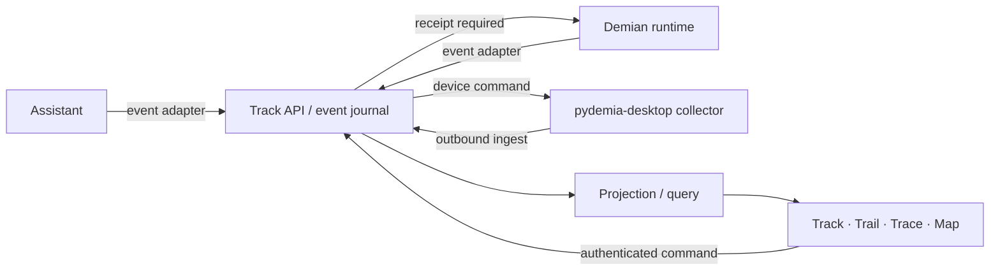

# Agent Track 제품 기획안

작성일·갱신일: 2026-11-12 KST · 상태: v0.4 기획·개발 순서 제안 · 사용자 확정: 제품명 Track, 하위 개념 Trail·Trace·Map, 통합 대상 세 앱, 서비스 주소와 저장소.

인증 결정 추가: 공개 서비스의 기본 로그인은 pydemia tenant의 Microsoft Entra ID입니다. 사용자 이름·비밀번호는 별도 로컬 관리자·테스트 경로에만 허용하며 공개 SSO 우회 수단으로 사용하지 않습니다. 앱별 OIDC client·cookie·secret을 분리하고 초기 접근은 소유자 계정으로 제한합니다. [실제 구성 상태](entra-sso.md)는 기획과 별도로 기록합니다.

2026-11-12 추가 요구: Demian의 cross-platform·cross-session Task/subagent 조직화와 최종 목표 수행을 중심으로 네 화면을 구분합니다. 실제 FlowCanvas 재사용·관계 의미·native 증거 경계·후속 개발은 [업무·협업 Flow 개편](mission-ui-plan.md)을 따릅니다.

Node group은 UI의 기본 탐색 단위에 포함합니다. 여러 Task가 만드는 작업 묶음과
그 내부의 실행·협업 흐름을 접기/펼치기와 내부 탐색으로 읽습니다. 그룹에는 목적,
현재 구성, 진행·대기 근거와 외부 연결을 표시하고, 선택한 가지를 깊게 펼쳐도
상위 문맥을 유지합니다. 기존 그룹 기능과 추가할 요약·화면 간 탐색은
[작업 묶음 중심 탐색 시나리오](mission-ui-plan.md#작업-묶음-중심-탐색-시나리오)에서 구분합니다.

## 1. 목적과 제품 경계

Agent Track은 여러 앱에서 실행되는 업무를 프로젝트·목표·작업 단위로 모아 보고, 승인·중단·재개·재시도를 원래 실행 주체에 전달하는 통합 관리 앱입니다. 사용자는 “무엇이 실행 중인가, 무엇이 내 결정을 기다리는가, 어떤 근거로 완료됐는가”를 확인할 수 있어야 합니다.

웹의 기본 주소는 `track.pydemia.ai`, 저장소는 `pydemia/agent-track`입니다. 원본 AgentTrail은 `trail.pydemia.ai`에서 별도 벤치마크 도구로 유지합니다. 제품 내부 Trail 탭과 원본 AgentTrail 앱을 구분하며 두 앱의 상태·데이터베이스를 자동 공유하지 않습니다.

| 제품 | 기본 책임 | Track과 연결할 계약 | 현재 확인 범위 |
| --- | --- | --- | --- |
| Assistant | 자연어·음성 업무 지시, 사용자 소통, 결과 설명 | 업무·목표 등록, 실행 참조, 산출물과 사용자 응답 | persona README에 task·권한·원장·SSE·배포 기록 존재. 실제 연동 API는 추가 조사 |
| Demian | 개발 업무 실행, goal·cowork, 도구·권한·diff | session/run 이벤트, 실행 명령, 승인 결과, 실행 근거 | Demian README에 TUI·VS Code·웹 runtime 명시. adapter 계약은 추가 조사 |
| pydemia-desktop | 로컬 앱·파일·실행 환경 접근과 알림 | 장치 등록, collector, deep link, 로컬 실행 연결 | 이번 작업에서 구현 위치·API 미확인. 이 책임 배분은 제안 |
| Agent Track | 원본 연결·상태 투영·조회·제어 명령 중계 | 공통 ID·이벤트·명령·권한 계약의 소유자 | 조회 기반 구현·검증 중. 제어와 교차 앱 실기 미완료 |

모델 호출과 실제 프로세스 제어는 각 runtime이 담당합니다. Track이 runtime의 승인 정책을 우회하거나 중복으로 worker를 시작하지 않습니다. 기존 Task가 있으면 외부 ID를 연결하며 동일 업무를 새 Task로 복제하지 않습니다.

## 2. 주요 사용 흐름

1. Assistant에서 업무를 지시하면 Projects 등 원본 업무 앱이 생성·수락한 ID를 Track에 연결합니다. 단독 Demian 실행은 업무 미연결로 표시하며 관측만으로 업무를 새로 만들지 않습니다.
2. Demian이 작업을 시작하면 원본 Task에 Session·Run을 연결합니다. 재시도·재개가 새 Run을 만드는지는 원 runtime 계약을 따르며 과거 실행과 Run 단위 업무 연결 이력을 보존합니다.
3. 사용자는 Track의 '내 결정 필요'에서 요청의 대상·효과·권한 범위·유효기간을 보고 승인하거나 거절합니다. 실행 runtime의 수락까지 '전달 중'이며 완료로 표시하지 않습니다.
4. 실행이 실패하면 Trace에서 실패한 단계와 원문 근거를 확인합니다. 재시도는 새 명령·Run으로 남기고 이전 실패를 보존합니다.
5. 작업이 완료 보고되면 Trail의 변경 파일·테스트·산출물을 확인합니다. 실행 종료, 에이전트의 완료 보고, 검증 통과, 사용자 수용을 별도 상태로 보여 줍니다.
6. Map에서 의존 작업과 다른 세션의 파일 충돌을 확인하고 필요하면 해당 앱으로 이동합니다. Map의 node를 선택하면 같은 Task 상세가 열립니다.

## 3. 정보 구조와 화면

전역 탐색은 **전체 프로젝트 → Track / Trail / Trace / Map**이며 설정에는 연결 앱·장치·권한·보존 정책을 둡니다. 기본 진입은 특정 대표 저장소에 고정되지 않은 전체 프로젝트·세션 현황입니다. 프로젝트 선택은 지역 필터로 제공하고 각 행의 소속·장치/adapter 수집 범위·관측 시각을 유지합니다.

2026-11-11 사용자 피드백으로 초기안의 현재 프로젝트 기본 진입을 위와 같이 대체했습니다. 원본 AgentTrail에는 주요 프로젝트10개와 시험1개를 연결했으나, 이를 Assistant·Demian 자체 세션 API 연동 완료로 간주하지 않습니다.

| 화면 | 중심 정보 | 주요 행동 | 빈 상태·오류·복구 |
| --- | --- | --- | --- |
| Track | 작업 표, 실행 상태, 담당 runtime, 마지막 수신, 승인 대기 | 작업 선택, 원래 앱 열기, 지원되는 실행 명령 | 연결 전에는 adapter 연결 안내. 장치 단절은 마지막 관측과 stale 표시 |
| Trail | 시간순 작업 이벤트, 산출물, 파일 diff, 인계 | 시점·종류 필터, 증거 열기, 인계 내용 복사 | 수집 범위와 누락 구간 명시. 원본 삭제 시 메타데이터와 삭제 이유 유지 |
| Trace | Run 단계, 부모·자식 span, 도구 호출·오류·지연 | 실패 지점 선택, redacted 상세, 재시도 요청 | 지원하지 않는 span·비용은 unknown. 부분 수집 구간 표시 |
| Map | 프로젝트→목표→작업, 의존 관계, 실행 세션·산출물 | node 선택, 필터·확대·접기, 목록 보기 | 고립 node 표시. 순환 의존 경고. 키보드로 동일 내용 탐색 |
| 작업 상세 | 목표, 상태 근거, Run 목록, 산출물, 명령 이력 | 탭 간 이동, 중단·재개·검토 | 권한 없음/미지원/연결 끊김을 각각 설명하고 버튼 상태에 반영 |

탭 간 전환 시 projectId·taskId·runId·시간 범위를 URL에 유지합니다. 브라우저 뒤로 가기로 선택·필터를 복구합니다. 검색 초안은 프로젝트별로 보존하되 다른 계정으로 넘기지 않습니다. 명령 전송 중 연속 클릭은 동일 idempotency key로 병합합니다. 오류는 선택과 입력을 유지하며 다시 시도할 수 있습니다.

### 화면 구성 기준

상단은 프로젝트·연결 상태·검색, 좌측은 네 영역 탐색, 본문은 작업 표 또는 타임라인, 우측 상세는 선택한 작업에만 나타납니다. 모든 지표를 카드로 분리하지 않고 동일 작업을 행으로 비교합니다. 승인 요청과 실행 명령은 영향을 받는 작업 상세 안에 둡니다. SNB는 접기·너비 조절·설정 보존을 제공하며 작은 화면에서는 기본 접힘으로 시작합니다. 지도와 본문이 남는 공간을 사용하도록 하고 세션·상세 패널이 주요 조작을 가리지 않게 배치합니다.

넓은 화면에서는 목록과 상세를 나란히 보여 주고 좁은 화면에서는 상세를 별도 화면으로 전환합니다. 상태는 색과 문구·아이콘을 함께 사용합니다. graph를 읽기 어려운 사용자를 위해 같은 관계의 표를 제공합니다. 전체 키보드 탐색·visible focus·상태 변경 안내·reduced motion을 수용 조건으로 둡니다.

`docs/prototype.html`은 같은 예시 Task를 네 영역에서 탐색하는 검토용 시안입니다. 운영 데이터·명령 실행과 연결되지 않았습니다. 실제 pydemia UI component를 사용한 결과가 아니라 화면 구조를 모사한 예시입니다.

## 4. 상태와 완료의 의미

| 구분 | 상태 | 전이 기준 |
| --- | --- | --- |
| Task | planned, ready, running, waiting_input, blocked, review, done, cancelled | source가 보고한 작업 상태와 검증·수용 이벤트로 결정 |
| Run | queued, starting, running, succeeded, failed, cancelled, interrupted, unknown | runtime의 receipt·종료 이벤트가 기준 |
| Connection | connected, delayed, offline | heartbeat와 최종 수신 시점 기준. 실행 성공 여부와 독립 |
| Command | requested, accepted, running, succeeded, failed, expired, unknown | receipt 없이 요청만 전달됐으면 accepted로 올리지 않음 |
| Verification | not_requested, pending, passed, failed, unavailable | revision·실행 명령·결과·증거가 연결되어야 passed |

silent timeout이나 파일 변경만으로 Task를 done으로 만들지 않습니다. 에이전트 완료 보고는 review로 이동하며, 프로젝트 정책에 맞는 검증/사용자 수용 후 done으로 전환합니다. 단절 후 종료 여부를 모르면 Run은 unknown으로 표시하고 runtime 조회 후 대조합니다. 진행률은 분모와 검증 기준이 있을 때만 표시하며 관측 이벤트 수로 임의 계산하지 않습니다.

## 5. 기능 요구와 수용 조건

아래 ID는 후속 구현·검증의 기준입니다. 구현·검증 상태는 goal 기준표에서 관리하며 시안 동작을 구현 완료로 집계하지 않습니다.

| ID | 단계 | 요구 | 관찰 가능한 수용 조건 |
| --- | --- | --- | --- |
| AT-01 | MVP | 프로젝트·Task·Session·Run 식별 | 같은 외부 세션의 재수신·재접속에도 중복 생성 0, ID 충돌 fixture 통과 |
| AT-02 | MVP | 실시간 Track | 실행/대기/승인/실패·최종 수신을 구분. 초기 조회와 stream 이후 동일 상태 |
| AT-03 | MVP | 끊김·재수신 | offline/stale 표시, cursor 이후 재수신, 누락 감지·snapshot 복구, 역순·중복 테스트 통과 |
| AT-04 | MVP | Trail·증거 | 변경 파일·artifact·원본 참조와 수집 범위를 조회. 누락 원문을 생성하지 않음 |
| AT-05 | MVP | 기본 Trace | Run→step→tool의 실제 제공 데이터만 표시. 실패·시간·출처와 unknown 확인 |
| AT-06 | MVP | 앱 간 이동 | 허용한 deep link로 동일 session/task 열기. 미설치·미지원 대체 링크 안내 |
| AT-07 | MVP | 조회 권한·redaction | 다른 계정·프로젝트 데이터 요청 거부, transcript·비밀값 fixture 비노출 |
| AT-08 | MVP | 화면·favicon | 네 영역, 빈/오류/단절, 키보드·좁은 화면, favicon 실제 bytes·탭 검증 |
| AT-09 | 제어 | 중단·재개·재시도 | capability 기반 노출, idempotency, receipt 대조, timeout 시 unknown·중복 실행 방지 |
| AT-10 | 제어 | 승인 요청 | 대상·효과·범위·만료 표시, 원 runtime 정책 재검증, 만료·중복·철회 처리 |
| AT-11 | 제어 | 작업 등록·배정 | 기존 Task 외부 ID와 연결, runtime acceptance 후 시작, 실패 시 초안 유지 |
| AT-12 | 관계 | Map·node group | dependency·parent_run·artifact 관계를 구별, 출처·시각 표시, 목록 대체·순환 감지. 원본/명시 binding/사용자 화면 묶음을 구분한 중첩 그룹, 접기·펼치기·내부 탐색·상위 복귀와 깊이별 보기, 원본 node/edge 근거 보존. 묶음의 목적·구성·대기 원인·입출력과 외부 관계를 근거 범위에서 요약하고 선택한 가지의 흐름을 깊게 탐색 |
| AT-13 | 운영 | 장기 데이터·복구 | 보존/삭제 정책, 원장 backup·restore 후 receipt/cursor 정합 검사 |
| AT-14 | 운영 | 교차 앱 검증 | Assistant 지시→Demian 실행→desktop 접속→Track 검토의 실기 시나리오 통과 |
| AT-15 | MVP | 전체 프로젝트 기본 대시보드 | 첫 진입에서 여러 프로젝트·장치의 세션을 함께 조회. 프로젝트 필터와 해제 후 동일 선택/상태 유지. 미연결·수집 누락·stale 구분 |
| AT-16 | MVP | SNB 접기·너비 조절 | 721–960px에서도 본문 너비 확보. pointer·키보드 조절, 설정 복원, 좁은 화면 기본 접힘·Escape·focus 복귀 확인 |
| AT-17 | MVP·운영 | Entra 기본 인증 | Track 전용 OIDC client로 실제 로그인·logout·API/SSE 접근 검사. 공개 Basic 우회 차단. 로컬 관리자·테스트 권한 분리 |

MVP는 조회 흐름(AT-01~08·15~17)을 먼저 검증하는 단계이며 최종 제품은 AT-09~14까지 포함한 실행·작업 관리 앱입니다. 세 앱의 공통 API가 확인되기 전에는 제어 완료일을 확정하지 않습니다. 단계별 작업·현재 상태는 [개발계획](development-plan.md)에 연결합니다.

### Demian 논의 통합: 원본 소유권과 문맥 요약

2026-11-11 사용자가 지정한 대화 `01a1c901-2cea-7a21-9b38-8d12445f0a49`의
[연동 제안](../../demian/docs/agent-track-integration/proposal.ko.md)을 개발 방향에 통합합니다.
Projects가 Project/Task·revision·수용 조건을, Demian이 Workspace/Session/Run·
실행 권한을 소유합니다. Track은 조회용 투영·binding 이력·명령 receipt를
소유합니다. 기본 구성은 독립 Track + Demian 연결 실행 요약 + Projects 업무
실행 요약이며, 조회 장애는 두 원본 앱의 대화·업무 편집을 차단하지 않습니다.

| 추가 ID | 요구 | 수용 조건 |
| --- | --- | --- |
| AT-18 | native 관계 구분 | invocation·cowork·managed-child·peer를 원본 ID·권한·근거와 함께 구별하고 고유 Run만 집계 |
| AT-19 | 업무 원본·binding | Projects revision·Run 단위 연결 이력 보존, task 수용·agent report·검증·Run 종료 구별 |
| AT-20 | 두 앱의 문맥 요약 | 같은 업무/세션 선택, 원본 인가 교집합·서버 인증 조회, Track 장애 격리·토큰 없는 링크 |
| AT-21 | 실제 Demian 관측 | 실제 native Run snapshot/SSE를 Track에 표시하고 재접속·원본 상태/관계 대조 |

실행 관계 Map이 기본이며 코드 활동은 별도 보기입니다. 계획 dependency,
호출 parent, peer provenance, 파일 귀속을 같은 선으로 합치지 않습니다.
Projects의 요구사항 영향 trace는 runtime Trace와 구별합니다. 비용·진행률·
파일 conflict가 미측정이면 0 또는 확정값을 만들지 않습니다.

## 6. 공통 데이터·이벤트·명령 계약 제안

주요 객체는 Project, Goal, Task, Session, Run, Agent, Device, Event, Command, Approval, Artifact, Evidence, Relation입니다. Task 1:N Run, Session 1:N Run, Run 1:N span/event이며 다른 앱 참조는 `source + source_instance + external_id`로 보존합니다. 하나의 Task가 여러 Session에 걸쳐 이어질 수 있습니다.

Event v1 최소 필드는 `schema_version, event_id, source, source_instance, device_id, project_id, task_id?, session_id?, run_id?, parent_run_id?, sequence, occurred_at, received_at, type, payload, evidence_ref?, redaction_version`입니다. 원본 ID와 정규 ID mapping은 삭제·재연결에도 유지합니다.

예시 event type은 `task.created`, `run.started`, `step.finished`, `tool.failed`, `approval.requested`, `artifact.created`, `run.finished`, `verification.completed`, `device.heartbeat`입니다. 정규화 adapter는 알 수 없는 이벤트를 quarantine하고 schema 오류를 보고하며 정상 이벤트 수신은 계속합니다.

수집은 at-least-once를 전제로 event_id dedupe·source별 sequence gap·cursor checkpoint·backfill을 구현합니다. occurred_at의 시계 오차를 표시하고 다른 장치 사이의 timestamp를 인과 순서로 단정하지 않습니다. 변경 원장은 append-only로 남기고 화면 조회용 projection을 별도로 구성합니다.

Command v1은 `command_id, idempotency_key, actor_id, target_runtime, task_id, run_id?, action, expected_version, grant_ref, expires_at`과 receipt를 가집니다. runtime의 capability 목록에 없는 action은 요청하지 않습니다. 제어 권한은 조회 권한과 별도이며 요청 시와 실행 직전에 확인합니다. 재개는 프로세스 부활·새 Run 생성 중 runtime이 제공하는 의미를 화면에 명시합니다.

제안 API: `GET /v1/projects`, `/tasks`, `/runs/:id`, `/events?cursor=...`, `/stream`, `POST /v1/ingest`, `/commands`, `/approvals/:id/decision`. 실제 앱의 현재 endpoint라는 주장이 아니며 adapter 조사 후 확정합니다.

## 7. 배치 구조 제안

초기 제안은 TypeScript 웹·API와 SQLite 기반 단일 사용자 서버입니다. collector는 로그·파일을 로컬에서 읽고 허용된 정규 이벤트만 outbound로 전송합니다. 원문 transcript와 전체 파일은 기본 업로드하지 않습니다. 다중 사용자·writer가 실제 필요해지면 PostgreSQL 전환을 검토합니다. SSE는 화면 전달, 인증된 HTTP 명령/receipt는 제어에 사용하고 양방향 상시 연결은 실제 요구가 확인된 후 채택합니다.

`track.pydemia.ai`는 Cloudflare 앞단과 상시 서버를 제품 제안으로 삼습니다. Workers/D1/Durable Objects는 즉시 필수 구성으로 넣지 않습니다. 로컬 파일 관측은 클라우드만으로 수행할 수 없으며 desktop collector 또는 해당 runtime의 이벤트 발행이 필요합니다. 모델 provider credential은 각 runtime에 남깁니다.

## 8. 원본 AgentTrail 벤치마크 해석

확인한 원본 revision: `3785d4ea62ca58b9ded853b2e4c3b99f12c02c97`. 근거는 로컬 `agenttrail-benchmark/README.md`와 evidence 파일입니다. 이번 작업에서 벤치마크를 재실행한 결과는 아닙니다.

| 관찰 | Track에 반영할 결정 |
| --- | --- |
| 로컬 파일·로그·PLAN을 지도와 세션으로 결합 | 선언한 계획과 관측한 실행을 별도 출처로 보존 |
| 합성 기능 14/14 통과, 실제 Codex 세션 6개 인식 | adapter fixture와 실기 교차 검증을 분리 |
| Codex task는 관측 당시 모두 unknown | 로그만으로 작업 원장을 복원하지 않고 명시 Task 이벤트 지원 |
| 로그 도구 이벤트 최초 관측 중앙값 907ms / p95 2693ms | ingest·projection·stream·렌더링 지연을 분리 계측 |
| 파일 변경→SSE 중앙값 2.79ms, PLAN→API 171.79ms | 작은 fixture 결과이며 제품 SLA·모델 속도와 혼동하지 않음 |
| 전체 Windows 검사 230개 중 208 통과·21 실패·1 skip | Windows 경로·worktree·재시작·cleanup을 별도 필수 검증 |
| 원본은 agent 실행·배정·완료 판정을 하지 않음 | Track은 명령 원장·승인·receipt 계약을 별도 구현 |

원본의 로컬 관측 방식·지도·출처 표시를 우선 벤치마크합니다. 코드 재사용 시 원본 MIT 저작권·고지와 실제 복사 범위를 THIRD_PARTY_NOTICES에 남깁니다. 이번 기획·접속 도구에는 원본 코드를 복사하지 않았습니다.

## 9. 디자인 시스템과 자산 인계

`ui.pydemia.ai`를 기본 component 공급원으로 삼습니다. 웹 조회가 실패해 로컬 ui 저장소의 registry.json을 읽었습니다. 후보는 `pyd-data-table`/`pyd-table`, `pyd-tabs`, `pyd-badge`, `pyd-timeline`, `pyd-dialog`, `pyd-button`, `pyd-flow-canvas`, `pyd-tokens`입니다. React 19·Tailwind 4·TypeScript 기반이며 graph는 `@xyflow/react@12.12.0`, dialog는 Radix 의존성을 명시합니다. prototype인 공급원임을 README에서 확인했습니다. variant/state, 실제 token 값, 항목별 provenance/license와 접근성 검증 상태를 확정하기 전에는 채택 완료로 기록하지 않습니다.

| 요구 | 필요한 component/state | 토큰 역할 | 적용 위치·확인 기준 |
| --- | --- | --- | --- |
| AT-02 | table / selected·stale·empty | surface, foreground, muted, status | Track; 같은 행 정렬과 선택 범위 유지 |
| AT-04/05 | timeline, tabs, code / partial·error | spacing, divider, mono, destructive | Trail/Trace; 원문과 요약·미수집 구간 구분 |
| AT-09/10 | action, dialog / pending·expired·denied | focus, warning, primary | 작업 상세; 효과 범위·중복 클릭 확인 |
| AT-12 | graph + relationship table | node/edge role, selected | Map; 같은 관계를 키보드·목록으로 탐색 |

favicon은 필수입니다. 승인된 pydemia 심벌 재사용 가능 여부를 확인한 후 SVG와 16/32px ICO 또는 PNG fallback을 준비합니다. 현재 시안의 T 글자 아이콘은 임시 자산입니다. 제품 배포 시 head 경로·Content-Type·인증 redirect·CSP·HTML fallback·실제 bytes/hash·light/dark·브라우저 탭/cache를 검사합니다. 현재 제품의 별도 A favicon SVG/PNG/ICO와 인증 후 관측한 공개 bytes/hash·탭 표시는 검증했습니다. 예시 HTML의 임시 아이콘과 구별합니다.

시안의 HTML/JavaScript 구문은 확인했습니다. 브라우저 도구가 file URL을 차단하여 실제 렌더링·조작·좁은 화면 검수는 미실행입니다. 시안을 다운로드하거나 로컬 브라우저에서 직접 열어 검토할 수 있습니다. 제품 UI의 수용 검사를 통과한 산출물로 취급하지 않습니다.

## 10. 단계별 구현과 검증

| 단계 | 산출물과 소유 범위 | 선행 조건 | 종료 기준 |
| --- | --- | --- | --- |
| P0 계약·범위 확정 | 앱별 API·ID·권한·capability 목록, 이벤트 schema·fixture | 접근 가능한 소스/문서 | 읽기·제어 지원 표와 미지원 fallback. desktop 미확인은 해당 연동만 보류 |
| P1 실데이터 관측 MVP | 공통 원장, 첫 collector, SSE, 전체 프로젝트 Track·Trail·기본 Trace·Entra | P0의 ID·schema | AT-01~08·15~17의 해당 범위. 한 장치·여러 프로젝트의 실제 로그와 화면 연결 |
| P2 세 앱 연결 | Demian·Assistant adapter, desktop bridge, 장치 등록·인계 | 각 앱의 실제 read 계약 | 세 앱의 실제 Task/Run을 공통 ID로 조회. 미지원 명령은 비활성 표시 |
| P3 실행 관리 | command ledger, approval, 취소·재개·재시도, 등록·배정 | runtime 명령/receipt 계약 | AT-09~11, timeout·철회·재시작의 중복 실행 0 |
| P4 관계·운영 | Map, 보존·복구, 상시 배포, 교차 앱 시나리오 | 안정된 관계 ID와 운영 auth | AT-12~14, 실기 흐름·복구·장시간 관측 통과 |

성능 수용의 초기 제안은 100개 동시 Run·초당 50 event의 고정 fixture에서 ingest→화면 p95 2초 이내, 30분 단절 후 재수신 데이터 누락 0입니다. 목표치이며 아직 측정하지 않았습니다. 하드웨어·브라우저·로그 adapter 버전·sampling을 고정하고 CPU/메모리·전송량·unknown 비율을 함께 기록합니다. 실제 요구 규모를 확인한 뒤 목표를 조정합니다.

즉시 다음 구현은 P0와 그에 의존하지 않는 P1 기반 작업입니다. 기존 프로젝트/작업 원장의 소유권, 앱별 제어 capability, pydemia-desktop 코드 위치/bridge를 조사합니다. 운영 인증은 Entra ID로 구성했고 Track 전용 로그인·API/SSE·logout·재로그인을 검증했습니다. desktop 미확인을 이유로 공통 원장·첫 실데이터 화면까지 모두 대기하지 않습니다. 구현 일정은 계약 조사 후 추정합니다.

## 10.1 현재 달성 상태

2026-11-11 구현 goal을 시작했습니다. 제품 웹·API·SQLite 원장·Demian snapshot/SSE adapter·Codex metadata collector를 작성하고 검증 중입니다. 실제 native Run 관측과 단일 소유자 취소·receipt, 백업/별도 복원을 검증했습니다. 재개·승인·Projects/Assistant/desktop의 native 연결은 남아 있습니다. 현재 전체 수용 기준은 AT-01~21이며 [goal 기준표](goal-status.md)와 [개발계획](development-plan.md)에 상태·증거를 기록합니다. Entra 준비와 AgentTrail 검증을 제품 완료로 환산하지 않습니다.

최근의 다중 프로젝트 관측·SNB 개선·원본 PR #21은 벤치마크 앱 작업입니다. 이 경험을 바탕으로 Track의 독립 SNB·전체 저장소 조회를 구현하고 실기 검사했습니다. 기존 예시 HTML은 검토용이며 현재 실제 제품 React 화면과 구별합니다.

## 11. 근거

- [원본 README](https://github.com/sodiumsun/agenttrail/blob/3785d4ea62ca58b9ded853b2e4c3b99f12c02c97/README.md)
- [원본 observability](https://github.com/sodiumsun/agenttrail/blob/3785d4ea62ca58b9ded853b2e4c3b99f12c02c97/docs/OBSERVABILITY.md)
- [원본 ingest](https://github.com/sodiumsun/agenttrail/blob/3785d4ea62ca58b9ded853b2e4c3b99f12c02c97/docs/INGEST.md)
- 로컬 `C:/Users/pydemia/git/agenttrail-benchmark/README.md` 및 `evidence/benchmark-results.json`, `evidence/codex-latency.json`
- 로컬 `C:/Users/pydemia/git/persona/README.md`, `C:/Users/pydemia/git/demian/README.md`
- [Cloudflare Tunnel origin 설정](https://developers.cloudflare.com/cloudflare-one/networks/connectors/cloudflare-tunnel/configure-tunnels/origin-parameters/)
