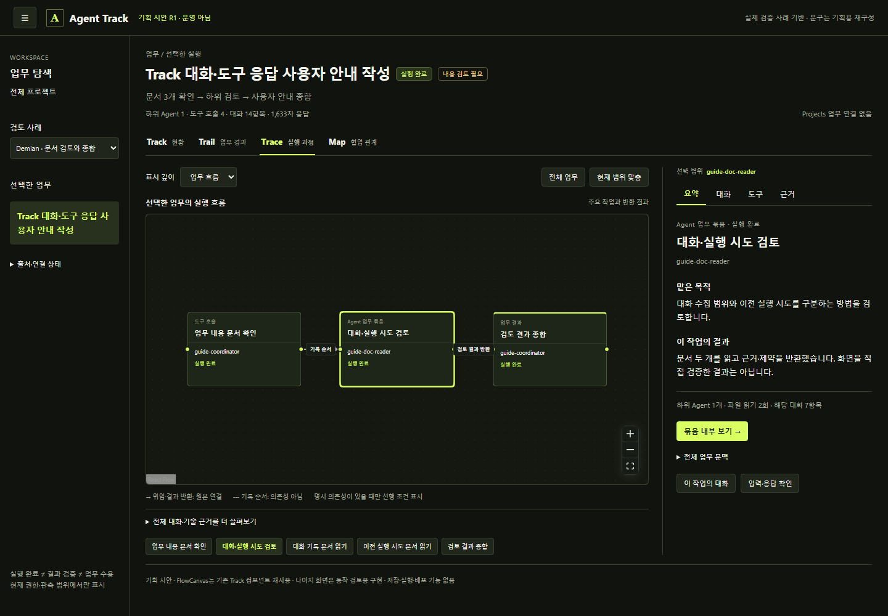
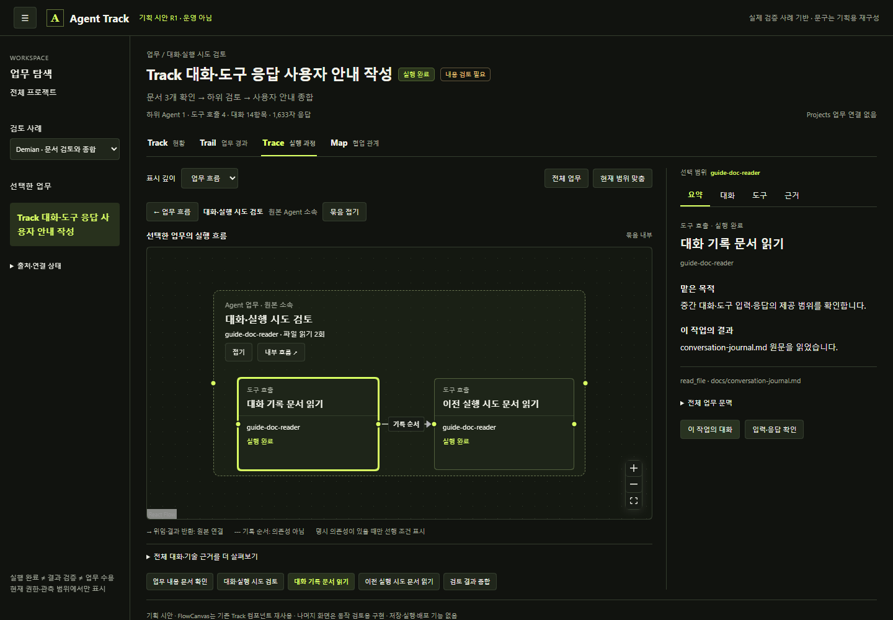

# Agent Track 업무 흐름·내용 전달 개선안

작성일: 2026-11-20 KST · 기획 revision R1 · 구현 전 제안

## 1. 목표와 기준

사용자가 Track에서 **어떤 업무인지, 누가 어떤 일을 맡았는지, 어떤 결과가 나왔고 무엇이 남았는지** 먼저 이해하고, 필요한 깊이까지 대화·도구 원문과 실패 근거를 확인하도록 개편한다. Demian의 cross-platform·cross-session 업무 조직화와 Assistant의 업무·역할·실행 시도를 같은 업무 문맥에서 읽는다.

기준은 기존 `mission-ui-plan.md`, 2026-11-20 실제 업무 검증, 기존 Assistant의 실패·취소·성공 기록이다. 실제 Demian 검증에서 하위 Agent 1개, 도구 호출·응답 4쌍, 대화 14항목, 이벤트 900개를 대조했다. 조회·귀속 기능은 확인됐지만 내부 호출 ID, 큰 그래프, 선택 범위보다 먼저 나오는 전체 Run 결과, Markdown 문법 노출이 이해를 방해했다.

이번 산출물은 기능 기획·UI/UX 기획·동작 시안이다. 아래의 개선 기능과 새 데이터 계약은 구현 전 제안이다. 시안은 운영 API를 호출하지 않으며 실제 검증 사례의 문구를 읽기 쉽게 재구성했다. 기존 검증을 제품 전체의 수용 완료로 확대하지 않는다.

## 2. 권장 화면 구조

기본 진입은 **Track의 업무 현황**이다. 업무를 선택하면 현재 목적·핵심 결과·진행을 막는 원인·남은 확인을 먼저 읽고, Trail·Trace·Map에서 같은 업무 문맥을 유지한다.

```text
전역: 프로젝트 / 업무 검색 / 출처·연결 상태
  └─ 업무: 제목 · 목적 · 실행 상태 · 결과 검토 · Projects 상태
       ├─ Track  현황과 다음 판단
       ├─ Trail  수행 경과와 당시 메시지
       ├─ Trace  Agent·위임·도구 실행 과정
       └─ Map    프로젝트·업무·앱·Session·Agent의 관계

화면 중심: 선택 범위의 목록 또는 흐름
오른쪽: 선택한 업무·묶음·Agent·도구·실행 시도의 상세
보조 영역: 원본 식별자 · 수집 범위 · 모델 요청 · 정규 이벤트
```

상단에는 선택한 업무의 문맥을 한 번만 표시한다. 전체 Assistant 실행 목록과 출처별 장문 설명은 전역 탐색·접힌 보조 영역에서 연다. Map 진입 직후 그래프가 화면 밖으로 밀리지 않게 한다. Sidebar의 기존 경계 드래그·스크롤·접기 기능을 보존하고, 작은 화면은 drawer로 전환한다.

### 탭별 목적과 기본 콘텐츠

| 탭 | 사용자가 답을 얻는 질문 | 기본 표현 | 심화 탐색 |
| --- | --- | --- | --- |
| Track | 무엇이 진행 중이고, 무엇을 판단해야 하나? | 업무별 목적·현재 수행·결과·대기 원인·다음 행동을 정렬한 행 | 역할·시도·Projects 상태·근거 있는 진척 |
| Trail | 어떤 일을 거쳐 지금 상태가 됐나? | 의미 있는 수행 경과와 메시지·결과가 함께 있는 타임라인 | 호출 입력·응답, 실패 직전 맥락, 필터와 원본 순서 |
| Trace | Agent가 어떻게 위임하고 도구를 사용했나? | 주요 작업과 Agent 묶음의 node·edge | 묶음 내부 → 도구 → 모델 요청·정규 이벤트 |
| Map | 여러 업무·앱·Session이 어떻게 연결되나? | Project·Task·앱·장치·Session·Agent·산출물의 관계 | 명시 선행 관계, cross-session handoff, 해당 실행 Trace |

Trace는 실행 과정, Map은 조직·소속·업무 의존 관계를 우선한다. 같은 그래프를 제목만 바꿔 네 탭에 반복하지 않는다. 제공되지 않은 업무 설명이나 관계는 추정해서 채우지 않는다.

## 3. 기능 요구사항

| ID | 기능 | 관찰 가능한 수용 기준 |
| --- | --- | --- |
| WR-01 | 업무 중심 진입 | 선택한 업무의 목적·핵심 결과·미해결 판단이 기본 화면에 표시됨. 원본 Project·Task가 없으면 연결 없음 표시 |
| WR-02 | 의미 있는 이름 | Agent·도구의 실제 이름·대상·목적이 제목에 표시됨. UUID는 접힌 출처 상세에서 확인 |
| WR-03 | 선택 범위의 상세 | 하위 Agent를 선택하면 해당 위임 목적과 해당 응답이 먼저 나옴. 전체 Run 결과는 별도 문맥으로 제공 |
| WR-04 | 호출별 대화·도구 | 원본 invocation·call에 정확히 귀속된 입력·응답만 표시. 관련 없는 페이지가 빈 결과처럼 보이지 않음 |
| WR-05 | 그룹과 내부 탐색 | 원본 소속·업무 연결·화면 묶음을 구분. 접기·내부 진입·상위 복귀·경계 edge의 원본 추적 가능 |
| WR-06 | 관계 의미 | 위임·결과 반환·명시 의존·소속·기록 순서·재시도 의도가 서로 다른 label과 상세로 구별됨 |
| WR-07 | 읽기 화면 | 제목·목록·코드·표·안전한 링크로 응답을 읽고 원문 보기로 전환 가능. 원문 hash·순서 보존 |
| WR-08 | 실패와 실행 시도 | 이전 실패에 최신 성공 응답이 표시되지 않음. 원본 오류·보고 주체·원인 미확정·재시도 연결을 구별 |
| WR-09 | 깊이와 상태 보존 | 업무 흐름에서 현재 그룹을 읽을 크기로 표시. 갱신 후 pan·zoom·선택·읽는 위치가 불필요하게 초기화되지 않음 |
| WR-10 | 부분·legacy·권한 | 미수집·미제공·미리보기·부분·조회 오류·접근 불가를 구분. 권한 철회·계정 변경 시 이전 본문 제거 |
| WR-11 | 진척의 근거 | 실행 종료·Agent 보고·검증·Projects 수용을 별도로 표시. 근거 없는 완료율을 계산하지 않음 |
| WR-12 | 반응형·접근성 | 1440·900·390px에서 선택 범위·소속·읽기 순서 보존. 키보드로 목록·그룹·edge·상세 탐색 가능 |

## 4. Node와 이름

이름의 근거는 원본 Task 제목 → 역할에 부여된 업무 → Agent 표시 이름과 위임 목적 → 도구의 검증된 입력 대상 순으로 사용한다. 제목을 바꿔도 원본 객체의 ID와 범위는 유지한다. 모델이 임의로 작성한 요약은 `Agent 보고`로 표시하고 구조화된 실제 결과와 구분한다.

| 대상 | 현재 사례의 표현 | 제안 표현 | 이름의 근거 |
| --- | --- | --- | --- |
| 하위 Agent | 호출 + 내부 invocation ID | 대화·실행 시도 검토 / guide-doc-reader | 해당 위임 task와 Agent 이름 |
| 파일 읽기 | read_file | 대화 기록 문서 읽기 / conversation-journal.md | 해당 호출의 tool·input.path |
| 결과 | 목적 | Track 사용자 안내 초안 작성 | 업무 제목 + 실제 응답의 산출물 성격 |
| Workspace | UUID | 문서 검토 작업공간 | 원본 Workspace 이름. 없으면 `작업공간 이름 미제공` |
| 과거 시도 | 같은 업무 제목 반복 | 시도 1 · 실행 실패 / 시도 2 · 취소 / 시도 3 · 메모 작성 | 시도 ordinal·원본 상태·결과 |

원본에 이름이 없으면 `하위 Agent · 이름 미제공`, `파일 읽기 · 대상 미제공`처럼 무엇이 빠졌는지 쓴다. 임의 ID를 업무 설명으로 대신하지 않는다. 긴 제목은 구분에 필요한 작업 동사·대상을 우선하고 상세·키보드 목록에서는 전체 제목을 읽을 수 있게 한다.

이 예시의 읽기 쉬운 작업명은 **제안된 표시 이름**이다. 현재 원본에 같은 이름의 독립 Projects Task가 생성됐다는 뜻은 아니다.

## 5. 상세 패널

공통 탭은 **요약 / 대화 / 도구 / 근거**다. 요약에서 목적·결과·실패·남은 판단을 읽고 관련 탭으로 이동한다. 원문은 필요한 범위에 요청 시 조회한다.

| 선택 대상 | 요약의 첫 내용 | 추가 내용 |
| --- | --- | --- |
| 업무 | 목적·현재 수행·핵심 결과·남은 판단 | 역할·시도·Projects 설명과 실행 당시 요청의 차이 |
| 실행 시도 | 그 시도의 요청·최종 응답·오류 | 이전/현재 시도와 재시도 명령·원본 상태 |
| Agent | 맡은 목적·해당 Agent 응답·실패 | 부모/자식, 전달받은 자료·반환 내용, 해당 대화 |
| 도구 | 대상 작업·입력·실제 응답·성공/실패 | 전체 출력·부분 파일 범위·발생 시각·해당 invocation |
| 그룹 | 묶음의 목적·구성·상태 분포·경계 관계 | 묶음 종류·부분 관측·원본 근거·내부 흐름 |
| edge | 출발/도착·관계의 의미·근거 | 순서/의존의 차이·원본 sequence·경계 안의 실제 endpoint |

하위 Agent를 선택했을 때 전체 Run 결과가 상단에 반복되지 않게 한다. 전체 문맥은 별도 disclosure로 제공한다. 해당 Agent의 최종 응답이 수집되지 않았다면 마지막 진행 메시지를 최종 결과로 대체하지 않고 `최종 응답 미확인`으로 표시한다.

도구는 입력·응답을 한 쌍으로 읽는다. 긴 출력은 본문 영역에서 확장·이어 읽기를 제공한다. `원본 도구 응답`과 `원본 파일 전체`는 다르므로 도구가 파일 일부만 읽었다면 읽은 구간·다음 구간을 표시한다. 도구의 실패와 모델·Run·업무의 실패를 서로 대신하지 않는다.

대화는 해당 호출의 진행·메시지·반환 결과를 시간/저장 순서에 맞게 제공한다. 진행 중 새 메시지는 자동으로 독자의 위치를 바꾸지 않고 `새 기록 n개`로 알린다. 탭 이동 시 현재 항목·스크롤을 유지하고, 다른 시도로 이동하면 범위와 cursor를 새로 설정한다.

Markdown 읽기 화면은 HTML 실행을 허용하지 않는 renderer, URL protocol allowlist, 안전한 코드·표 overflow를 사용한다. `읽기 / 원문`을 전환해도 원본 문자열은 변경하지 않는다. 시안의 본문은 기획용 문구와 HTML 구조이며 운영 Markdown renderer 구현·보안 검증을 대신하지 않는다.

## 6. Group과 in-depth 탐색

### 세 종류의 묶음

| 묶음 | 생성 근거 | 가능한 동작 | 의미 |
| --- | --- | --- | --- |
| 원본 소속 | 실행·invocation·cowork group/member·Session의 명시 관계 | 접기·내부 진입·원본 근거 보기 | 실제 관측된 구조 |
| 업무 연결 | 현재 허용된 Project·Task·역할·실행 연결 | 업무 범위 보기·관련 시도 선택 | 명시된 업무 연결. 같은 Task라는 이유로 다른 역할의 본문 범위를 확대하지 않음 |
| 화면 묶음 | 사용자의 선택과 저장 보기 | 이름 변경·구성·접기·보기 저장 | 개인 탐색 구성. 원본 Task·실행 의존·수용 상태는 바꾸지 않음 |

묶음 내부 진입 시 breadcrumb와 현재 묶음 제목을 유지한다. 기본은 현재 묶음 내부의 주요 작업을 보여주며, 실제 구조에 필요한 만큼 더 들어갈 수 있다. 예시의 `업무 → Agent → 도구 → 기술 근거`는 탐색 단계의 예이며 중첩 깊이의 고정 상한이 아니다.

접힌 묶음은 이름·담당 Agent·구성 개수·상태 분포·막힌 항목을 표시한다. `3/3 조회됨`과 `3/3 완료`를 구별한다. 일부만 수집했으면 전체 완료나 성공률로 집계하지 않는다. 사용자 묶음의 색이나 이름으로 원본 성공을 표현하지 않는다.

경계를 통과하는 edge는 그룹에 대표선으로 연결하되 원본 endpoint·관계 종류·근거를 보존한다. 서로 다른 관계 종류를 한 개의 ‘연결’로 합치지 않는다. 대표선 선택 시 실제 원본 관계 목록을 읽고 해당 내부 node로 이동한다.

큰 그룹은 작업 목록과 상태 분포로 개요를 읽고 필요한 내부 범위를 렌더링한다. 모든 node를 축소해 한 화면에 맞추는 것을 기본 동작으로 삼지 않는다. 선택한 그룹에 맞춤, 원래 보기 복귀, 키보드 목록 탐색을 함께 제공한다. 기본 글자 크기를 유지하고 넘치는 범위는 pan·목록·그룹 내부 이동으로 탐색한다.

## 7. Edge와 cross-platform·cross-session Map

| 관계 | 표현 | 인정하는 근거 |
| --- | --- | --- |
| 명시 선행 조건 | 방향 실선 + `선행 조건` label | Projects dependency 또는 검증된 원본 dependsOn |
| 위임·결과 반환 | 방향선 + `위임`/`결과 반환` label | 부모 invocation·위임 호출·실제 반환의 명시 연결 |
| 소속 | 점선·무방향 + `소속` label | Project/Task/앱/장치/Session/Agent의 원본 소속 |
| 기록 순서 | 얇은 파선 + `기록 순서` label | 같은 허용 범위의 저장 순서. 인과·의존 보장 없음 |
| 재시도·재개 | 방향 파선 + `재시도 요청`/`재개 요청` | 원본 명령 또는 coordinator intent. Native 접수·성공과 별도 |
| 참조·미확정 | 참조 label과 불확실성 표시 | 참조만 있고 대상 생명주기/연결이 미확인인 경우 |

색상만으로 구분하지 않고 label·선 모양·상세 설명을 함께 사용한다. 선 교차·label 겹침·그룹 헤더의 hit target을 실제 화면에서 검사한다.

Map은 선택한 업무와 현재 허용된 이웃 관계를 기본 범위로 둔다. 앱·장치·Session의 이름을 표시하고 다른 업무로 연결되는 edge에서 범위를 넓힌다. 다른 플랫폼에서 같은 Agent 이름이나 같은 파일을 사용했다는 사실만으로 같은 실행·의존 관계로 합치지 않는다.

handoff는 넘긴 목적·자료·결과·보낸/받은 Session의 실제 receipt가 있을 때 연결한다. 수신측 권한이 없으면 허용된 범위의 참조·접근 상태만 표시하고 본문을 읽지 않는다. 이번 실기 사례는 단일 Native 업무와 하위 Agent 검증이며, 다중 기기의 종합 업무를 이미 검증했다는 근거로 사용하지 않는다.

## 8. 상태·진척·오류

실행 상태, Agent의 완료 보고, 결과 검증, Projects 수용을 별도 필드로 둔다. 성공 종료한 Run의 출력에도 편집 필요·검증 미완료가 있을 수 있다. 오류는 원본 메시지·보고 주체·코드·현재 선택 시도와 함께 제공하고, 구체 원인이 없으면 원인 미확정을 명시한다.

진척은 확인된 계획/수용 항목의 달성 근거로 계산한다. 이벤트 수, node 수, 경과 시간, Run 성공 수를 업무 완료율로 사용하지 않는다. 분모와 판정 기준이 없으면 비율 대신 `확인된 수행 / 남은 확인 / 막힌 이유`를 표시한다. 같은 비율이 오래 유지되면 마지막 실질 변화·대기 조건·현재 관측 시각을 함께 보여준다. 연결 끊김은 작업 정체와 구별한다.

| 상태 | 화면 동작 |
| --- | --- |
| 로딩 | 선택 범위를 유지하고 현재 범위 조회 중 표시. 오래된 본문을 새 node의 본문으로 노출하지 않음 |
| 빈 결과 | `해당 범위에 원본 기록 없음`과 `현재 페이지에 관련 기록 없음`을 구별 |
| legacy/미수집 | 수집 이전 기록임을 표시하고 복원을 암시하지 않음 |
| 부분/미리보기 | 제공된 범위·이어 읽기·원문 여부를 항목 수준에서 표시 |
| 연결 오류 | 범위·오류·다시 조회를 제공. 기록 없음으로 표시하지 않음 |
| 권한 변경 | 이전 본문과 캐시 제거, 계정·범위 재검사. 기존 URL·저장 보기로 우회하지 않음 |
| 여러 오류 근거 충돌 | 원본 근거별로 표시하고 최종 원인을 임의 선택하지 않음 |

## 9. 데이터와 연동 개발 요건

### 기존 구현에서 재사용

- FlowCanvas, node/edge 선택, 그룹 내부 탐색·보기 저장·경계 대표선
- 업무/시도 본문 reader와 현재 권한 재검사
- Run conversation paging, 원본/미리보기/legacy 표시, invocation+call 범위 대조
- Assistant 역할·실행 시도·Projects 연결과 명시된 retry/resume 관측
- 기존 Sidebar 경계 drag·scroll, 현재 브랜드·favicon·색상 token

### 보완할 계약

1. **표시용 요약 모델:** `title`, `purpose`, `result`, `failure`, `nextCheck`, 각각의 원본 참조·제공 범위·판정 주체를 반환한다. 요약이 원문을 대체하지 않는다. 기존 정규 이벤트 payload·digest에 이름·본문을 뒤늦게 넣지 않고 별도의 요청 시 projection으로 구성한다.
2. **정확한 선택 범위:** actor·source·Project/Task·Execution·role·attempt·Run·invocation·call을 실제 존재하는 수준까지 고정한다. UUID가 같아도 source/actor/시도 범위가 다르면 다른 대상이다.
3. **Agent 최종 응답 구분:** host가 기록한 `progress/final` 또는 이에 해당하는 신뢰할 수 있는 marker를 제공한다. producer가 제공하지 않으면 최종 응답 미확인을 유지한다. 모델이 입력에 적은 가짜 marker를 host provenance로 승격하지 않는다.
4. **범위별 대화 paging:** 현재 Run 페이지를 화면에서 필터하는 방식의 빈 페이지 문제를 해결한다. Native의 버전 구분된 scoped 조회에서 invocation/call을 고정하고, scope·원본 generation·권한에 묶인 cursor를 사용한다. 긴 본문의 조각 위치도 보존한다. 서버가 아직 지원하지 않으면 제한된 탐색 상태·이어 찾기를 명시하며 전체 이력 조회로 표현하지 않는다.
5. **도구 표시 정보:** 해당 call의 input 대상·도구명·outcome·원문 응답·출력의 부분 범위를 별도로 제공한다. 이름을 얻기 위해 임의 도구 출력 전체를 metadata 원장에 복사하지 않는다.
6. **Persona 연동:** 보호 업무의 historical attempt reader·signed gateway·허용 route/query를 새 scope 계약과 함께 갱신한다. 조회 전후 owner/Projects/역할·시도 fence를 유지한다. 첫 페이지뿐 아니라 이어 읽기·scope 변경·revocation도 확인한다.
7. **분류·그룹 projection:** 원본 구조·업무 binding·사용자 보기 상태를 구분하고 별도 필드로 보존한다. 화면 묶음을 실제 업무 dependency로 write-back하지 않는다.

페이지 제한은 reader별로 안내한다. 기존 요약 본문 reader의 항목 32,000자·메시지 80개·총 128,000자 제한과 새 journal의 항목 조각 16,000자·페이지 총 96,000자 제한을 구별한다. cursor 이동은 전체 기록의 한계와 별개다. 현재 구현의 숫자를 새 UI의 영구 계약으로 고정하지 말고 버전·capability에서 실제 범위를 표시한다.

## 10. 컴포넌트·token·출처

2026-11-20 공개 registry의 `pyd-flow-canvas.json`, `pyd-tokens.json`을 HTTP 200으로 읽었다. 웹 reader는 해당 JSON을 열지 못해 HTTPS fetch로 확인했다. 로컬 pydemia/ui source revision은 `eed2173e54bc82478dc9781ec4c0e67b0a480f54`다. Track의 기존 FlowCanvas는 이 제품에 조정된 소스이므로 registry 최신 파일로 일괄 교체하지 않는다.

| 요구 | 대응 항목 | 적용·조정 |
| --- | --- | --- |
| 그래프·node·edge·group | pyd-flow-canvas / 현재 Track FlowCanvas | 시안에서 **실제 현재 컴포넌트** 재사용. 표시 이름·선택·노출 깊이·스타일만 시안에서 조정 |
| 상세 탭 | pyd-tabs | 제품 구현 시 기존 stack에 맞춰 채택. 시안은 native button으로 동작 모사 |
| 접기·원문 확장 | pyd-accordion / native details | 그룹의 scope와 선택을 유지. 시안은 native details |
| 소속 경로 | pyd-breadcrumb | 의미·aria-current를 재사용. 시안은 간략 경로 표현 |
| 대화·도구 | pyd-message / pyd-tool-call | 원본/부분/실패 상태를 제품 계약과 연결. 시안은 HTML로 구성한 재구성 예시 |
| Sidebar·본문 스크롤 | 기존 경계 drag·scroll / pyd-scroll-area | 기존 구현 보존·조정. 새 resizable 항목을 확인했다고 주장하지 않음 |
| 상태·수행 단계 | pyd-agent-status / pyd-work-plan | 실행 상태와 업무 수용·진척을 구별하도록 조정 |

공개 FlowCanvas registry SHA-256: `b53ea292ed034b9fddbe3ab06f768f6c129e0c77d5e8e79db8d3d09f2df2b6df`.
Token registry SHA-256: `a29e82f4844493867d7e6e2e99a271a2570816c40e9a5f18026d26ad880e943c`.

FlowCanvas는 pydemia 원본 구현, `@xyflow/react@12.12.0`은 MIT다. Tabs·Accordion·Breadcrumb·ScrollArea는 shadcn/Radix 기반 항목이며 각 원본 MIT 고지·의존성 검토를 구현 인계에 포함한다. 이번 시안은 해당 항목 소스를 새로 복사하지 않았다. 라이브러리 metadata의 키보드 검증·screen reader 검수 대기 상태와 Track 제품의 접근성 통과를 구분한다.

기존 `--bg/--surface/--ink/--muted/--lime/--amber/--red`를 semantic background·surface·foreground·muted·accent·warning·danger 역할에 연결한다. lime은 선택·강조, amber는 검토 필요, red는 실패에 사용하며 색상 외 문구·굵기·상태 label을 함께 제공한다. 활성 Sidebar 행은 배경·글자색·굵기로 표시한다.

## 11. 시각적 그룹화·반응형·접근성

| 영역의 의미 | 구분 단서·소유자 | 좁은 화면·상태 예외 | 확인 기준 |
| --- | --- | --- | --- |
| 업무 문맥 | 한 개의 제목 영역·목적·상태별 label | 긴 제목 줄바꿈, 별도 상태 축 유지 | 제목만 읽고 업무·현재 판단 구별 |
| 동급 작업 | 같은 node 형식·크기·단어 순서 | 긴 이름은 상세/목록에서 전체 읽기 | 같은 수준 작업을 같은 역할로 인식 |
| Agent 내부 | 그룹 제목·소속 label·공동 영역 | 내부 진입 시 상위 breadcrumb 유지 | 원본 소속과 화면 묶음 구별 |
| 선택 상세 | 오른쪽 독립 pane·상단 범위 label | 중간 폭은 아래로, 모바일은 목록 우선+상세로 이동 | 선택한 범위의 목적·결과가 첫 내용 |
| 실행 기록 | 정렬된 순서·Agent 표시·도구 disclosure | 긴 코드/표는 해당 영역에서 스크롤 | 페이지·부분 범위·실패 주체 구별 |

1440px은 업무 탐색+흐름+상세를 함께 제공한다. 900px에서는 상세를 아래로 옮겨 그래프를 읽을 폭을 확보한다. 390px에서는 업무 경과/목록을 기본으로 하고 그래프는 사용자가 선택한다. 제품의 중간 폭 상세 전환 시 선택·읽는 위치·포커스를 보존한다. 이는 검토용 기준 폭이며 최종 breakpoint는 내용·실측에 따라 결정한다.

키보드로 작업 목록→node/edge→상세를 이동하고, 그룹 진입·상위 복귀 후 출발 control로 focus를 돌린다. 선택 node·그룹·edge의 이름과 상태가 접근 가능한 이름에 포함돼야 한다. 모바일 상세 이동에는 제목 focus와 닫기·복귀가 필요하다. 실제 screen reader·touch 조작은 후속 제품 검수 대상이다.

기존 승인 favicon을 재사용한다. 시안은 실제 favicon.ico 파일을 사용했다. 제품 배포 때 SVG/PNG/ICO 경로·Content-Type·auth redirect·CSP·fallback·실제 bytes와 브라우저 탭 표시를 확인한다. 이번 로컬 시안의 파일 존재를 운영 favicon 검수 완료로 기록하지 않는다.

## 12. 구현 순서와 완료 기준

| 순서 | 구현 묶음 | 선행 조건 | 완료 기준 |
| --- | --- | --- | --- |
| 1 | 선택 범위·결과 요약·의미 있는 제목 | 원본 identity/attempt 계약 점검 | 하위 Agent node 상단에 해당 목적·응답 표시. 파일 읽기 세 개를 대상 이름으로 구별. legacy는 결과 미확인/미수집 보존 |
| 2 | 읽기 패널·도구 입력/응답·범위별 paging | Native/Persona scope reader와 marker 보완 | 첫 페이지에 관련 기록이 없어도 오해 없는 이어 읽기. 긴 출력·Unicode·권한 철회·잘못된 시도 분리 |
| 3 | 업무 흐름 기본값·그룹 내부·집중 보기 | 표시용 projection·그룹 분류 | 모델 요청은 심화 탐색. 접기·대표선·내부 진입·복귀·saved view·갱신 중 선택/viewport 보존 |
| 4 | Trail·Track·Map의 역할 분리 | 내용 요약과 관계 projection | 탭마다 질문에 맞는 표현 제공. 업무 현황의 다음 판단, Trail 맥락, Map cross-session 근거 확인 |
| 5 | 실제 운영 검증·문서·배포 | 앞선 묶음과 실제 자료 | Assistant·일반 Demian·보호 Persona 경로의 실제 성공/실패/취소/재시도 대조 후 API+web 동시 배포 |

첫 번째 구현에서는 사용자가 즉시 읽는 이름·선택 범위·결과를 우선한다. 새 런타임 marker와 scoped paging은 원본 수집/조회 변경이므로 읽기 UI와 분리해서 설계·검증하고, 지원 여부에 따라 명시적으로 fallback한다. 새 API가 필요한 UI를 먼저 운영에 게시하지 않는다. 코드 확인에는 기존 `build:check`, 후보에는 별도 outDir을 사용하며 복구용 `dist/web`를 교체하지 않는다.

필수 제품 검증 사례는 다음과 같다.

- 실제 Demian 문서 검토 업무: 도구 4쌍·대화 14항목·하위 대화 7항목을 node·상세·원본으로 대조
- 기존 Assistant 업무: 실패·취소·성공 시도를 이동해도 다른 시도 응답·원문이 섞이지 않음
- 보호 Persona reader: owner/source/Projects·시도 변경과 이어 읽기 도중 권한 철회 시 본문 제거
- 첫 관련 메시지가 뒤쪽 페이지에 있는 호출, 여러 페이지의 긴 도구 출력, 미리보기·빈 응답·미제공 출력
- 실제 명시 의존 관계·병렬 분기/합류·handoff가 있는 추가 업무와 부분 수집·범위 밖 대상
- 그룹 접기 전후 edge·실제 endpoint 보존, 이름이 같은 다른 장치/Session/역할 분리, saved view 복원
- Markdown 링크·HTML 문자열·코드·표와 원문 대조, 작은 화면의 focus·scroll·긴 한국어

사용성 평가는 사용자가 제목만으로 업무를 구별하고, 하위 Agent의 맡은 목적·실제 결과·실패 주체를 설명하며, 관련 도구 응답을 찾는 과제로 진행한다. 성공 여부·오선택·탐색 시간은 기준 화면과 같은 자료로 측정한다. 이번 기획 시안만으로 이해도·속도 개선률을 주장하지 않는다.

## 13. 시안과 확인 결과

권장안 하나를 구체화했다. 사용자에게 기존에 합의한 방향을 A/B 선택으로 다시 묻지 않는다. 소스는 [preview.tsx](workflow-reading-v2/preview.tsx), [스타일](workflow-reading-v2/preview.css), [실행 안내](workflow-reading-v2/README.md)에 있다.

- 
- 
- [Map의 소속·위임 관계](workflow-reading-v2/assets/proposal-map.png)
- [실패 시도 상세](workflow-reading-v2/assets/proposal-failure.png)
- [모바일 업무 경과](workflow-reading-v2/assets/proposal-mobile.png)
- [로컬 동작 시안](../../.runtime/flow-reading-v2/preview/index.html)

Edge headless에서 실제 현재 FlowCanvas의 node·edge 렌더링, 선택 범위의 상단 요약, 그룹 내부 진입·접기·펼치기, 키보드 선택, Map 소속 상세, 실패 시도의 도구 미제공, 900/390px 가로 넘침 없음, 모바일 Trail 기본 진입을 확인했다. 시안 타입 검사도 통과했다. 외부 네트워크 호출은 0건이다. 실제 운영 API·배포·전체 접근성·사용자 이해도는 이 기획의 검증 범위 밖이다.

확정된 사용자 방향은 업무 중심 전달, node·edge·group의 의미, 원본 앱 이동 없이 원문 확인, Entra 기본 인증이다. R1의 상세 탭·정보 배치·초기 깊이·구현 순서는 권장안이다. 제품 구현과 배포는 이번 기획 요청에 포함해 수행하지 않았다.
